# PowerProcurement

[](https://github.com/KartelSRBX/PowerProcurement/actions/workflows/ci.yml)
[](LICENSE)

**From a customer's request email to an approved purchase order.** The app turns a request email into a
supplier-offer comparison, a customer quote with a markup, and a supplier purchase order. AI does the routine
work (reads the email, drafts letters, extracts terms from supplier replies). **A human approves every action
that leaves the system.** Scoring, prices and margins are plain deterministic code, never AI.

> **Status: working end to end, AI steps not measured yet.** The whole path runs on synthetic data and templates
> with **no AI and no outside accounts**: request, suppliers and target prices, letters with approval, offers and
> scoring, customer quote with markup, outcome, purchase order, invoice request. The AI steps (email parsing,
> drafting, extraction) have their interfaces, a gold set and an in-app key field, but their accuracy is
> **not published until a live run has been made** (see [Parsing accuracy](#parsing-accuracy)).


*The tour was recorded with a scripted stand-in for the AI (no live API call), so it shows the flow and the controls, not real model quality.*

## Contents

1. [What it does](#what-it-does)
2. [What the AI is for](#what-the-ai-is-for)
3. [Install and run](#install-and-run)
4. [First five minutes](#first-five-minutes)
5. [The panel, tab by tab](#the-panel-tab-by-tab)
6. [How the numbers are computed](#how-the-numbers-are-computed)
7. [Safe by default](#safe-by-default)
8. [Turning on the AI](#turning-on-the-ai)
9. [Configuration reference](#configuration-reference)
10. [Architecture and repository layout](#architecture-and-repository-layout)
11. [Develop and test](#develop-and-test)
12. [Troubleshooting](#troubleshooting)
13. [Roadmap](#roadmap) · [License](#license)

## What it does

A trading or procurement desk gets a request ("500 pcs of this microcontroller and 2000 capacitors") and has to
find suppliers, ask for prices, compare answers, quote the customer and place the order. PowerProcurement keeps
that whole path in one place, in eight steps:

| Step | What happens | Who does it |
| --- | --- | --- |
| 1. Request | An email becomes a structured request (items, quantities, category, language, deadline) | AI proposes (or you type it), **a person confirms** |
| 2. Suppliers | Suppliers that cover the items, are not sanctioned and did not fail their latest check are shortlisted | Code |
| 3. Target prices | Price lists give a target price per item, converted to EUR with the bank rate | Code |
| 4. Letters | Supplier letters are drafted in the supplier's language; **nothing is sent until a person approves** | Template or AI drafts, **a person approves** |
| 5. Offers | Supplier answers are compared and scored on price, lead time, reliability, terms and external risk | Code (weights are yours) |
| 6. Quote | Customer price = cost × (1 + markup), with a live margin preview and a markup hint from history | Code, **a person approves** |
| 7. Outcome | The customer's answer (accepted, rejected, counter-offer, silence) is recorded and feeds analytics | A person |
| 8. Order | Purchase order and invoice request, after the customer accepted and the budget checks pass | **A person approves** |

On top of that sit a mailbox, one approval queue, analytics, supplier profiles with due-diligence checks, an
encrypted access vault, a **Legal** tab that screens contracts against a playbook and a loaded norm base of laws, and a settings page where you enter your own API key.

## What the AI is for

A procurement desk spends most of its day on reading, matching, writing and chasing. That is where the AI works.
It is used as an assistant for **language and unstructured text** and nowhere else: it reads what people wrote,
proposes structure, drafts letters and explains results. It does **not** decide prices, scores or markups, does
not send anything and does not approve anything. Those stay in plain code and with a named person.

Every place below says what the AI does, what a person still does, and **what exists today**.
**Built** means it is in the code and works as soon as you paste an Anthropic key into **Settings**; without a key
the same step runs on a template or a hand-entry form, so nothing is blocked. **Planned** means designed, not coded.
Everything marked Built was tested against a scripted stand-in for the model (the repo has no key); it has **not**
been run against the live API, so read the first real answers critically.

| # | Job | What the AI does | What stays with code and people | Today |
| --- | --- | --- | --- | --- |
| 1 | Analytics of received requests | Classifies every email (request or not, language, category, confidence) and puts the numbers on **Message analytics** and **Pricing analytics** into words | Counting, funnels and forecasts are code; the words never change the numbers; a person decides what to do | Built: **Parse all with AI** in Mail, **Explain these numbers in words** on both analytics tabs |
| 2 | Understanding the request | Turns free text into items, quantities, budget, deadline, country; asks questions where it is unsure | A person confirms the request before anything is sent | Built (accuracy not measured yet) |
| 3 | Defining the supplier pool | Suggests suppliers the rules did not pick (by meaning, not keywords) and says why each candidate fits | Filters (category, sanctions, checks) are code and still apply; suggestions arrive **unticked**; a person ticks | Built |
| 4 | Preparing the supplier mailing | Drafts each letter in the supplier's language; also drafts the customer quote text | Code checks the draft (every item and quantity, the exact price) and falls back to the template; a person approves | Built |
| 5 | Collecting feedback | Reads a supplier answer (pasted, or a PDF / Excel / CSV / text file) into prices, lead time, MOQ, terms and gaps; explains the score table in words | **Code adds up the total**, warns about gaps; a person checks and saves the offer; scoring is code | Built (scanned PDFs without a text layer are not read) |
| 6 | Secondary mailing when something is wrong | Writes a precise follow-up for a silent supplier or an answer with gaps | Code decides **who** needs one; the letter waits in **Approvals** | Built |
| 7 | Invoice requests and the rest of the paperwork | Drafts the invoice request, the order confirmation to the customer, a delivery question to the supplier and a customer reminder; reads the customer's reply into a proposed outcome | A person edits and approves each letter and records the outcome | Built |
| 8 | Calculations (future) | Suggests customs codes from descriptions, reads supplier proforma and invoice fields, explains a calculation | The calculation itself is deterministic code | AI help planned; the calculation itself is built (the **Calculator** tab) |

### 1. Analytics of received requests

Incoming email is classified as it is read, before anyone looks at it: *is this a request at all* (newsletters, payment
confirmations and thank-you notes are not), in which language, for which category, with what confidence. Three ways to
run it: **Parse with AI** on one email, **Parse all with AI** in the Mail tab (reads up to 20 stored emails that have no
request yet and reports how many were parsed, need review, or are not requests; press again for the rest), and the
mailbox reader (`cd backend && uv run python -m app.intake.poll`, from IMAP or a folder of `.eml` files).
That tagging feeds **Message analytics** (volumes per day, the funnel from email to order, languages, categories, top
senders, average AI confidence) and keeps the queue free of noise.

The AI does not produce the statistics: they are counted from database records, and the markup forecast in
**Pricing analytics** is a transparent model whose inputs you can see. The AI's only job there is the button
**Explain these numbers in words**: it gets the numbers the page shows and writes a headline and a few points
("win rate drops fast above 25% for this customer"). It cannot change a figure, and the text says which model wrote it.

### 2. Understanding the request

One prompt (`backend/app/ai/prompts/intake/v1.md`) reads the email
and returns a strictly typed result (`backend/app/intake/schemas.py`): is it a request, language, customer, category,
items with quantity, unit and part number, budget with currency, needed-by date, delivery country, a list of
questions and a confidence between 0 and 1.

The prompt is written to avoid the usual mistakes:

- **Never guess.** A missing or vague quantity, price, budget or date is left empty and becomes a question for the
  customer instead of an invented number.
- **Only the new text.** Quoted earlier messages are ignored.
- **Serbian, English, other.** Latin and Cyrillic script both work; European number format (`1.234,50`) and relative
  dates ("in two weeks", "end of the month") are resolved against the date the email arrived.
- **Part numbers stay as written** and are kept separate from the description.
- **Low confidence goes to a person.** Below `AI_CONFIDENCE_THRESHOLD` (0.75 by default) the email is stored as *needs review*
  instead of moving on, and a person **always** confirms the request before any supplier is contacted.

Use it in **Mail → Parse with AI** or **Parse all with AI** (needs your key, see [Turning on the AI](#turning-on-the-ai)). Its accuracy is
measured on a gold set of 16 emails with `python -m app.intake.evaluate --live`; **no figure is published until that
run has been made**.

### 3. Defining the supplier pool

The rules in `backend/app/suppliers/shortlist.py` run first and always: the supplier must serve the request's category,
must not be sanctioned, must not have a newest check of *not working*, and must have a price line whose key appears in the
item text. Suppliers are ranked by how many items they cover, then by past deals, and up to five are preselected.

What the rules cannot do is understand that "100nF 0603 capacitor" and "MLCC 0.1 µF, 0603, X7R" are the same part, or
that a request for "a rack UPS" belongs with a supplier of power equipment that never wrote the word "UPS". With a key set,
**Find suppliers and prices** also sends the request items, the shortlist and up to 40 other eligible suppliers (name,
categories, brands, notes, check result) to the model. It may do two things:

- add up to **five** suppliers the rules missed, each with a reason, marked **AI** in the list and **left unticked**;
- append a short "why" to the suppliers already on the list.

The model can only pick from the eligible suppliers it was shown, so it cannot put a sanctioned or failed supplier on the
list, and nothing is asked until a person ticks the box. If its confidence is below the threshold, or the call fails, the
list is exactly what the rules produced and a note says why.

### 4. Preparing the supplier mailing

For every shortlisted supplier the system prepares a request-for-quotation letter in **that supplier's language**
(Serbian or English today) with the items, the data we need back (unit price and currency, minimum order, lead time,
payment terms, warranty, validity) and the right subject with the request number. With a key set the model writes the
letter; without one, or if the draft fails the checks below, the fixed template is used. Each letter carries a tag
(**AI · model name**, **template**, or **template · AI draft rejected**) so you can see which it is.

The checks are in code, not in the model: the text must not be a stub or contain a placeholder like `[Name]`; an RFQ must
mention **every item and its quantity**; a customer quote must contain **the exact price and the lead time** that
code computed, so the model cannot quote a number of its own. The same drafting layer writes the customer quote text.

Either way nothing is sent: the drafts wait in **Approvals**, a person edits the text and approves or rejects each
one, and only then does it go out (to Mailpit in the demo).

### 5. Collecting feedback

Suppliers answer in free text, in different currencies and layouts. In **Step 5 · Offers and scoring → Enter a supplier's answer** you pick the supplier,
paste their reply, or choose the file they sent (PDF, Excel `.xlsx`, CSV or text), and press **Read with AI**. The model fills a typed form: unit price and currency per item, minimum order,
lead time, payment terms, warranty, validity, anything unusual (substitutes, partial coverage), and what is **missing**.
Then **code** takes over: it multiplies price × quantity per item, adds the total, checks that every item has a price and
that the minimum order fits, and shows warnings (for example when prices come in two currencies the total is left empty
for you to decide). You see an editable form with these numbers; **nothing counts as an offer until you press Save as
offer**, and the saved offer records that a model read it (`ai-reviewed`). Without a key the same panel opens an empty form
and you type the numbers.

Once offers exist, **Explain in words** below the score table writes a few sentences about why the ranking looks as it does.
The model is shown the numbers code computed and can describe but not change them; the ranking, the five criteria and
your weight sliders stay code (see [How the numbers are computed](#how-the-numbers-are-computed)). In the demo, **Simulate
supplier answers** still stands in for real replies so the rest of the flow can be shown without any real supplier.

**Files.** The app first turns the file into plain text and shows it to you under *Text read from the file*, so you can see
exactly what the model was given. PDF: the text layer of the first 30 pages. Excel: up to 5 sheets, 300 rows and 30 columns each,
read as values (a formula that was never calculated is empty). CSV and text in UTF-8 or Windows-1250. Limits: 5 MB, about
19,000 characters of text. Not read: scans and photos (no text layer, there is no OCR), password-protected files, old `.xls`
(save as `.xlsx`). In each case the app says why and you paste the text or type the numbers instead. With a key set, the file's
text is sent to the Claude API like any pasted answer.

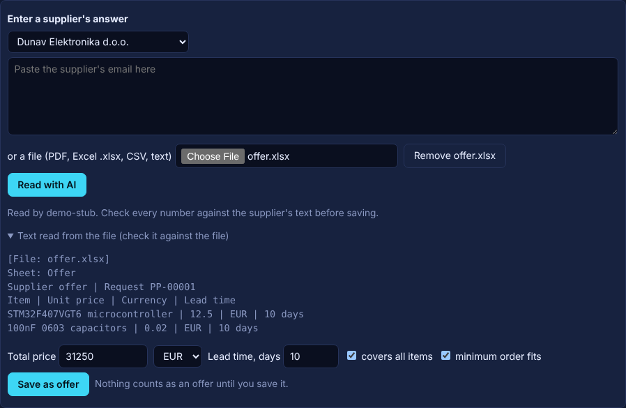

The same reading skill is used on the customer's side (step 7).

### 6. Secondary mailing when something is not right

The **Follow-ups to suppliers** section finds suppliers that need a nudge. **Code decides who**: a supplier we wrote to who has not answered
after `FOLLOWUP_AFTER_DAYS` days (3 by default; you can override it with the "silent for at least N days" box), or one whose
saved answer is incomplete (a missing lead time or validity, items without a price, a minimum order that does not fit).
Nobody is asked twice about the same thing: a supplier already written to since their last message is skipped.
**Draft follow-ups** then writes one short, specific letter per supplier in their language, asking only for what is missing
("please confirm the lead time for item 2"), or the template when AI is off. The letters appear in the same **Approvals** queue
as every other letter and leave only after a person approves them.

### 7. Invoice requests and everything around the order

- **Customer's answer.** Under a sent quote, paste the customer's reply and press **Read with AI**. The model proposes
  *accepted*, *counter-offer* (with the price they named), *rejected*, *silence* or *unclear*. It is only a proposal:
  press **Record this answer** to save it under your name.
- **Reminder.** **Draft a reminder** writes a polite nudge to a customer who has not answered a sent quote. It is a draft
  in Approvals; only one waiting reminder per quote, and none once an outcome is recorded.
- **Invoice request.** After the customer accepts and a person approves the purchase order (budget and below-cost checks
  passed), **Prepare invoice request** shows the letter to the supplier (the order's items and total, drafted by the model
  or the template). You edit it and press **Approve and send to supplier**; it is not sent before that.
- **Order confirmation.** After the purchase order, **Draft order confirmation to the customer** writes the confirmation
  with the items, the exact price from the quote that was sent and the supplier's lead time; code rejects a draft that changes
  the price. It waits in Approvals. One per order.
- **Delivery question.** **Ask the supplier about delivery** asks for the dispatch date, carrier, tracking number and shipping
  documents. It waits in Approvals; you can ask again later once the first one is sent.

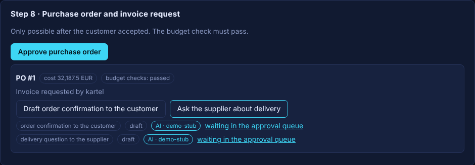

### 8. In the future: calculations

The **Calculator** tab holds the project's own landed-cost calculator (see below). The plan for the AI there is
narrow on purpose: suggest the **customs tariff code** from a product description, read the fields of a supplier's
proforma or invoice (price, quantity, weight, origin), and explain a finished calculation in words. Duties,
freight, VAT and exchange rates are then computed by deterministic code from a rate table, so the same inputs always
give the same result and the result can be checked line by line.

### Ground rules for every AI step

- **Structured answers only.** Each step returns a typed object with a confidence value, not free text that code has to guess at.
- **Uncertainty goes to a person.** Low confidence, missing data and conflicts become questions and review items.
- **No numbers from the AI.** Prices, scores, margins, budgets and limits are code; the AI extracts, drafts and explains.
  Totals are added up by code from what the AI read, and a draft that changes a number is thrown away.
- **No action without approval.** Sending a letter, quoting a customer, recording an answer and placing an order each need a named human.
- **Every step has a fallback.** No key, a failed call, a low-confidence or rejected answer: the step still works on a template
  or a hand-entry form. Failed calls are written to the audit log (`ai.failed`).
- **Explainable and reproducible.** Prompts are versioned files (`backend/app/ai/prompts/<name>/v1.md`); calls go through one adapter;
  tests and CI use a scripted stand-in for the model, so CI never spends money or depends on a live model.
- **Optional and swappable.** Without a key the app runs on templates and rules. The model is a setting
  (`AI_MODEL`), and everything that talks to the outside world sits behind an adapter.
- **You control the cost.** With a key set, the model is called only by these actions: Find suppliers and prices, Draft
  letters, Quote this (quote text), Read with AI, Explain, Draft follow-ups, Draft a reminder, Prepare invoice request, Draft order confirmation, Ask the supplier about delivery, a supplier file read, Parse
  with AI, Parse all with AI and, per contract, Ask the AI (Legal). Calls are billed to your own key; with the provider on `mock` none of them calls anything.

## Install and run

You need **[Docker](https://docs.docker.com/get-docker/) with Compose** and about 2 GB of free disk. Nothing else:
no Python, no Node, no database to install, no account, no `.env` file.

```bash
git clone https://github.com/KartelSRBX/PowerProcurement.git
cd PowerProcurement
docker compose up --build
```

The first start builds the images (a few minutes) and fills the database with **synthetic** demo suppliers.
When the log shows the frontend as healthy, open:

| What | Where |
| --- | --- |
| Web panel | http://localhost:3000 |
| Demo inbox (Mailpit), every outgoing email lands here | http://localhost:8025 |
| API health | http://localhost:8000/health/ready |
| API reference (interactive) | http://localhost:8000/docs |

**Stop and clean up**

| Command | Effect |
| --- | --- |
| `Ctrl+C` in the terminal | stops the containers |
| `docker compose down` | removes the containers, **keeps your data** |
| `docker compose down -v` | also wipes the database and the saved encryption key (a fresh start) |
| `docker compose up -d` | runs in the background |

If a port is taken, stop the program using 3000, 8000 or 8025 first. Windows and macOS: run the commands in a
terminal while Docker Desktop is running (on Windows, WSL 2 is the usual backend).

> Nothing leaves your machine. All outgoing email goes to Mailpit, the demo data is invented, and AI is off until
> you paste a key.

## First five minutes

1. Open http://localhost:3000. At the top right, type **your name** in the *Working as* box. Every approval and
   edit is recorded under it, and most buttons stay disabled until a name is there.
2. Open **Mail**, click **Load 16 demo emails**, pick an email and click **Confirm as request**.
   (Or use **Requests → Create request**, which comes with a sample prefilled.)
3. On the request page click **Find suppliers and prices**, then **Draft letters**.
4. Open **Approvals**, read a letter, edit it if you like and click **Approve and send (to Mailpit)**.
   The email appears in Mailpit at http://localhost:8025.
5. Back on the request: **Simulate supplier answers** (demo only, there is no real supplier), move the weight
   sliders, click **Score**, then **Quote this** on the supplier you prefer.
6. Approve the quote, click **accepted** as the customer's answer, then **Approve purchase order** and
   **Approve invoice request**.

Every outward step needs a name and is written to the audit log. The purchase order is refused before the
customer has accepted, when the order is above the budget limit, and when the agreed price is below cost.

## The panel, tab by tab

The left menu has twelve tabs. The top bar shows server and mail status, the AI state, a **dark / light theme
switch** (the first visit follows your system, the choice is remembered), a link to Mailpit and the *Working as*
name box.


### Requests

The home tab lists every request with its stage and has the form for a new one. Click a request number to open
its **pipeline page**: one page, eight steps, top to bottom, with the next action always named under the title.


**Create a request by hand.** Sender, subject, one item per line as `500 x part name` (quantity first),
category, the customer's language and an optional *needed by* date, then **Create request**. Items without a
quantity are accepted but block supplier lookup until you fill the quantity in.

**On the pipeline page**

| Step on the page | What to do | What you get |
| --- | --- | --- |
| Items | Review what was extracted | The confirmed item list |
| **Steps 2-3 · Suppliers and target prices** | **Find suppliers and prices**; untick any supplier you do not want to ask | A shortlist with a reason per supplier ("covers 2/2 items; 40 past deals; RS"), at most five preselected. With a key, extra suppliers suggested by the AI appear with an **AI** tag, unticked |
| **Step 4 · Letters** | **Draft letters**, edit the text, **Approve and send to Mailpit** or **Reject** | One letter per supplier in that supplier's language (Serbian, English), status `draft`, `sent` or `rejected`, with a tag showing who wrote it (**AI · model**, **template**) |
| **Step 5 · Offers and scoring** | **Enter a supplier's answer**: pick the supplier, paste their reply or choose a PDF / Excel / CSV file, **Read with AI**, check the form, **Save as offer** (without a key you type the numbers). Or **Simulate supplier answers (demo only)**. Then move the five weight sliders and **Score**; **Explain in words** | An offer per supplier; a ranked table with every criterion, landed cost in EUR and lead time; **Quote this** on a row |
| **Follow-ups to suppliers** | Set how many silent days count (optional), **Who needs a follow-up?**, **Draft follow-ups** | Letters for silent suppliers and incomplete answers; they wait in **Approvals** |
| **Steps 6-7 · Quote and outcome** | Set *Markup %* and the currency, approve the quote, then record the customer's answer: with the buttons, or paste their reply and **Read with AI**, then **Record this answer**. **Draft a reminder** if they stay silent | Quote with price, markup and cost tags; outcome `accepted`, `rejected`, `silence` or `counter-offer` (with the price they named) |
| **Step 8 · Order** | **Approve purchase order**, then **Prepare invoice request**, edit the text, **Approve and send to supplier**; **Draft order confirmation to the customer**; **Ask the supplier about delivery** | PO with its budget checks; the invoice request; two more letters in Approvals |
| Price journal | Read only | Every price event: supplier cost, quote draft, quote sent, with who did it |


**Delivery record.** Every order carries one: the date the supplier is expected to deliver, a status (ordered, supplier
confirmed the date, shipped, delivered, cancelled) and a history of every change with who made it and why. A new order gets a
first date from the offer's lead time, shown as "ordered, no confirmation yet": it is a calculation, not a promise, until a
person records that the supplier confirmed. Moving a date that is already set needs a reason, so the history says why it
moved. "Delivered" takes a delivery date (today unless given; never in the future) and closes the record, as does
"cancelled". Code works out how many days an order is overdue.

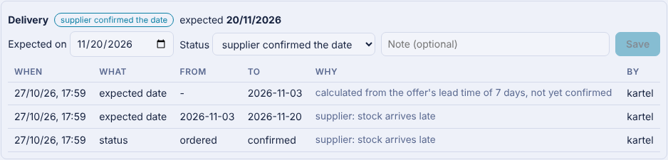

**Overdue deliveries.** On the Requests page, a list shows every order whose promised date has passed and that is neither
delivered nor cancelled, the most late first, with the days late and the state of the question to its supplier. **Prepare
question** (per order) or **Prepare questions for all** writes a letter asking why the delivery is late and when it will
come, in the supplier's language and with the promised date; AI writes the wording when a key is set and the text passes the
usual checks (reference, items, the promised date), otherwise a template does. The letter waits in **Approvals** as a "delay
question"; nothing is sent until a person approves it. No second question is drafted while one waits or within the follow-up
interval after one was sent (3 days to start with). Nothing runs by itself: the list is worked out when the page is opened.

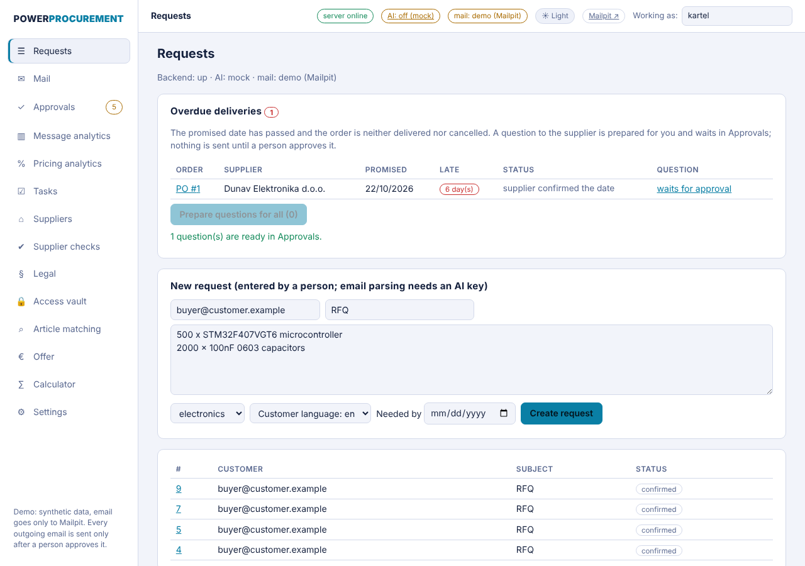

**The AI steps on this page.** The screenshots below were taken with a scripted stand-in model (note the `demo-stub` tag),
not the live API, so they show the layout and the controls, not real model quality.

A supplier's answer pasted (or a file chosen) and read: the form is editable, the missing item is named, nothing is an offer until you save it.

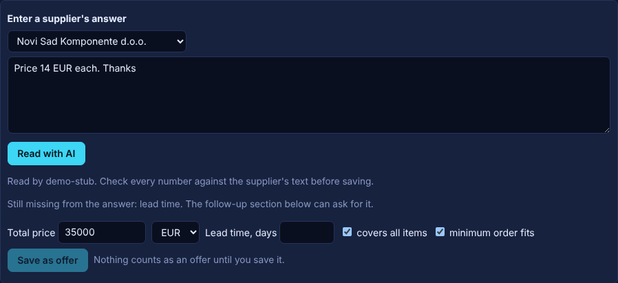

The score table with **Explain in words** (the explanation never changes the ranking):

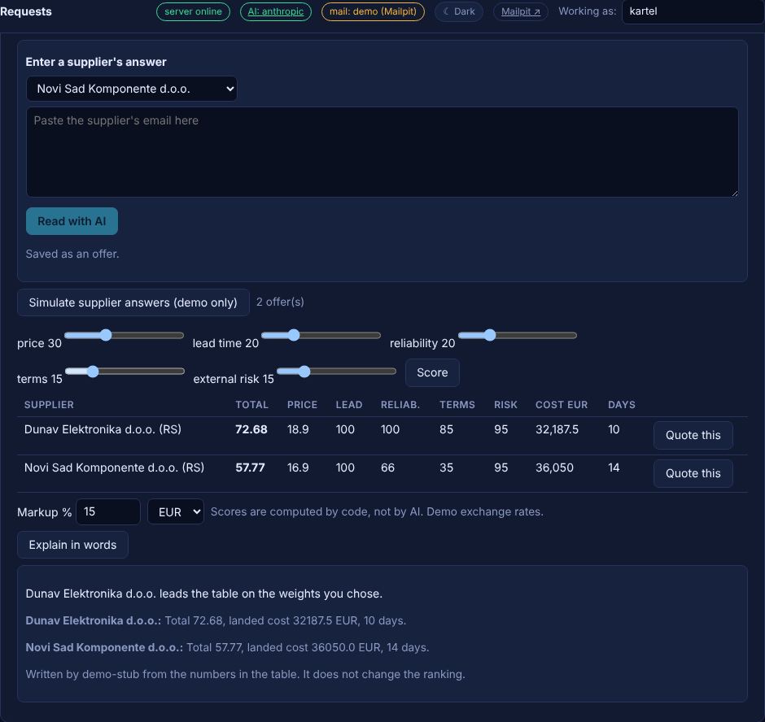

Follow-up letters for silent suppliers; they wait in **Approvals**:

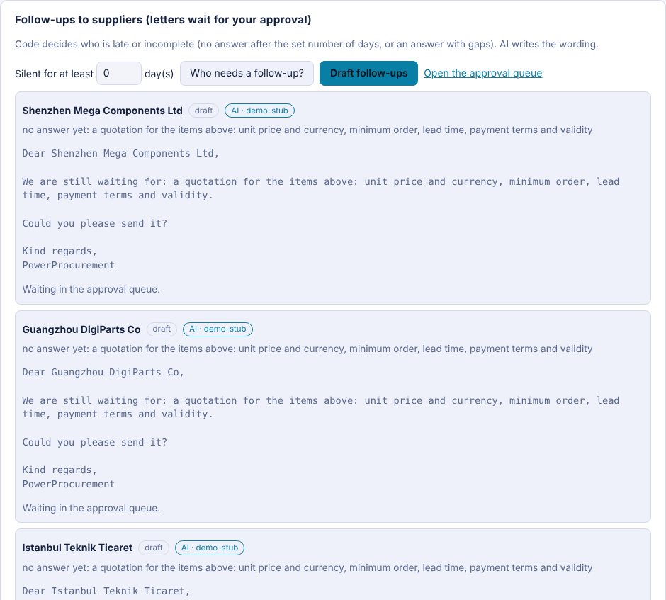

The customer's reply read into a proposed outcome, and the invoice request shown for editing before it is sent:

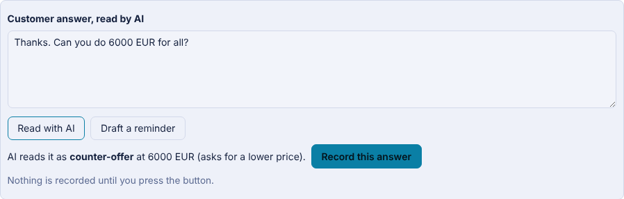

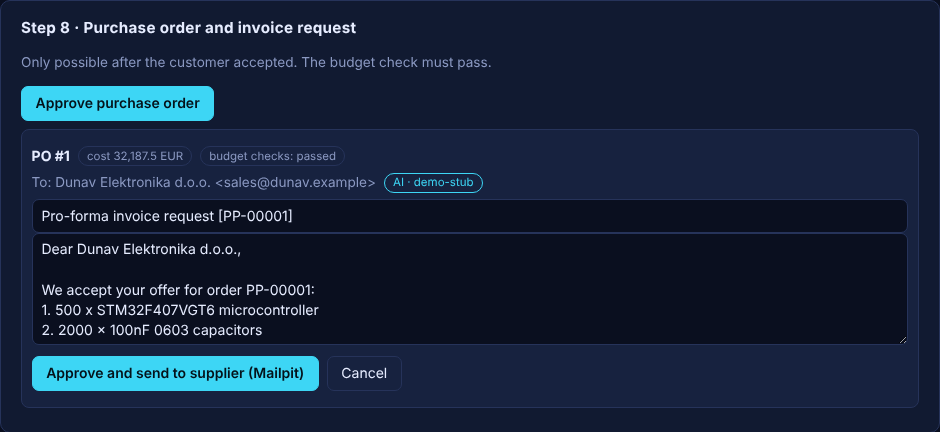

Notes: a supplier on the sanctions list, or one whose offer does not cover every item, is **excluded** and cannot
be quoted. A quote priced below cost is flagged *below cost* and cannot become an order.

### Mail

A mailbox with **All / Inbox / Sent** folders, search, and a detail pane. In the demo it holds sixteen synthetic
emails in English, Serbian (Latin and Cyrillic) and German, including newsletters and thank-you notes that are
**not** requests. Real inbox reading uses IMAP (see [configuration](#configuration-reference)).

Mail from suppliers is told apart from customer mail when the inbox is polled. Each approved RFQ goes out with a
Message-ID, so a reply that points back at it is matched exactly; otherwise the request number in the subject (`PP-00012`)
and the sender's address decide, and a known supplier with only one request waiting is matched by address alone. Doubtful
mail is shown as **unattached**: a person attaches it to a request and supplier, or says it is not a supplier answer.
Matching never creates an offer.
On the request page the mail waits under **Waiting to be read**; the **Read** button turns it into an answer a person checks and saves.


For an incoming email that has no request yet you get the **Create a request from this email** panel:

- **Parse with AI** (visible when AI is on) sends the email text to the Claude API and shows what it understood
  with a confidence value; you still confirm it.
- **Parse all with AI** (left column, needs a key) reads up to 20 stored emails that have no request yet and reports how many
  became requests to review, how many need review, and how many are not requests. Press it again for the rest.
- With AI off, the item list is drafted by a simple text rule. **Check and fix it**, pick category, language and
  *needed by*, then **Confirm as request**.

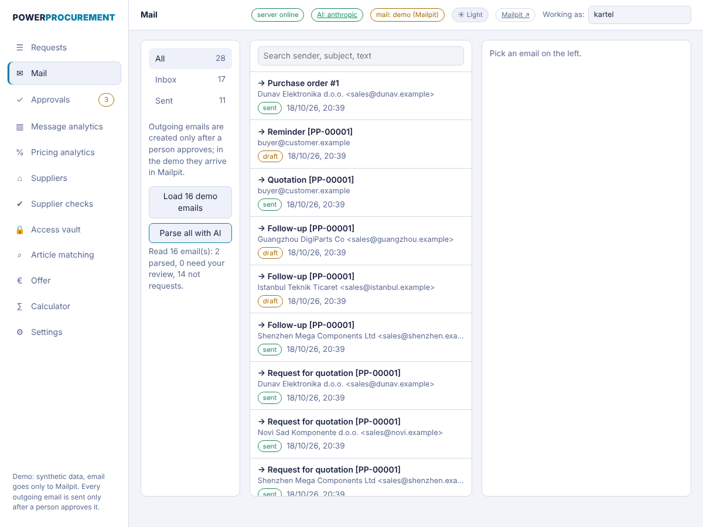

For an email that already has a request: **Open pipeline**, **Match articles**, **To the offer**. Sent mail shows
who approved it.

### Approvals

One queue for every letter waiting for a person: supplier letters (RFQs), customer quotes, supplier follow-ups, customer
reminders, order confirmations and delivery questions. **Waiting for approval** and **Decided** tabs, filter by *All / supplier RFQ / customer quote / supplier follow-up /
customer reminder / order confirmation / delivery question*. A tag shows when the first version was written by the AI.

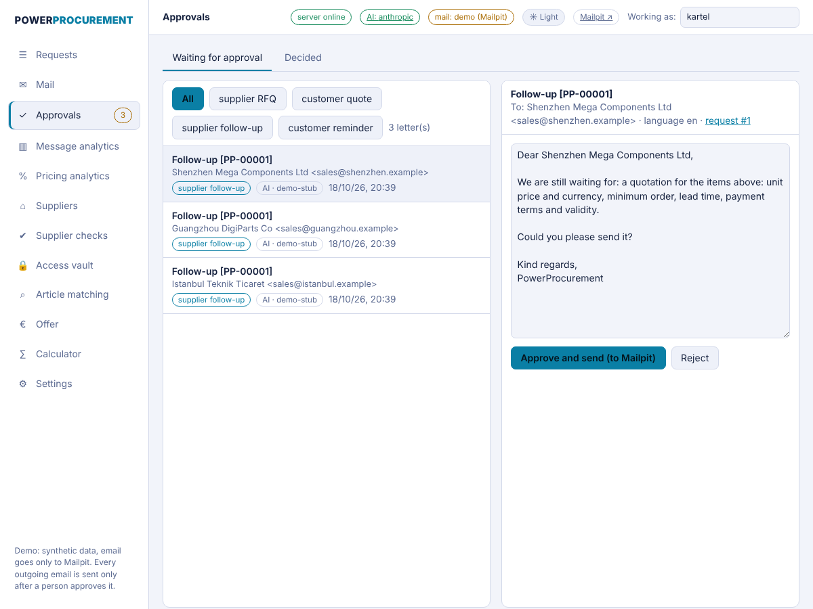


Pick a letter, read it, **edit the text in place** (edits are saved with your decision), then **Approve and send
(to Mailpit)** or **Reject**. Warnings (for example a price below cost) show in red on the letter. The number
beside *Approvals* in the menu is the count of letters waiting.

### Message analytics

Counted straight from the database: incoming emails per day (14 / 30 / 90 days), the funnel from email to order,
request statuses, email languages and categories, top senders, supplier RFQ response counts, customers' answers
to quotes, and items per request. **Explain these numbers in words** (needs a key) adds a short written summary of what the page shows.


### Pricing analytics

How often a quote is accepted at each markup, and which markup earns the most (markup × win rate). Filter by
customer and category. The page shows quotes in view, acceptance rate, average markup, the average discount
customers asked for, and a **suggested markup** with the expected win rate and margin per euro of cost, a win
rate bar chart, a margin chart and a per-customer table. Bars with fewer than eight quotes are drawn faded.


- **Load synthetic history** adds 600 invented quotes with planted patterns so the analysis has something to
  show. Their source is labelled *synthetic*; quotes you make yourself are labelled *live* and join the
  statistics once the customer's answer is recorded.
- The suggestion is only a hint. In **Offer** a **Use 22.5%** button copies it into the markup box; a person
  decides on every quote.

### Suppliers

Supplier storage with profiles, filters, sorting and price lists. Everything on this tab can be edited and every
edit is logged with your name.


**Find and sort.** The search box looks in name, email, brands and product types. The dropdowns are **cascading**:
pick a country and the category and brand lists shrink to what exists there, with counts. Further filters: role
in a brand (*vendor, distributor, sub-distributor, reseller*), partner status and check result. **Click a column
title** to sort (click again to reverse); sorting runs on the server, empty values go last, ties break by name.
Sortable columns: supplier, country, status, check, deals, payment days, stock days, brands, price lines.

**Profile** (select a supplier, then edit under *Profile* and **Save profile**)

| Field | Meaning |
| --- | --- |
| Status | `new`, `approved`, `preferred`, `on hold` |
| Payment | `prepayment`, `on delivery`, `deferred`, `credit` |
| Stock delivery, days | Typical delivery time for items in stock |
| Brands | Comma separated; for each brand a role: vendor, distributor, sub-distributor or reseller |
| Product types | Comma separated |
| Website, contract note, credit line (with note), rebates | Free text and a tick box |
| Discounts by brand | A list such as *Texas Instruments: 10% from 100 pcs*; add and remove entries |

**Delivery performance.** Under the profile, a panel summarises the supplier's delivered orders from their delivery records:
the share delivered on time against the date in force and against the first (calculated) date, how late the late ones were,
how often the promised date was moved later, and the real lead time (min, max, mean and spread) against the quoted one, with
the latest orders listed. Fewer than 3 delivered orders are marked as too few to judge by. *In full* is shown as not
measured, because the delivery record keeps no received quantity. Scoring can use the on-time record as an optional criterion (Settings, Scoring).

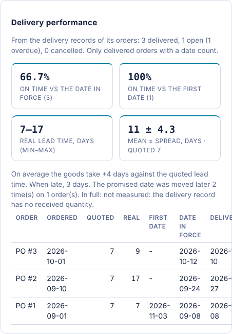

**Supplier facts used by scoring** are shown as tags (years in business, deals, payment days, warranty, VAT ID
verified, framework contract) with buttons to **+1 deal**, **mark/remove VAT mark** and **mark: sanctioned**. A
sanctioned supplier disappears from matching and mailings.

**Price list.** Each supplier has price lines (key, description, price, currency, MOQ, lead time, valid until).
Add a line by hand or **import a CSV**: choose a file or paste text, **Validate** (shows every row with its
errors), then **Import all or nothing**. Header and example:

```csv
keyword,description,unit_price,currency,moq,lead_time_days,valid_until
lm358,LM358 dual op-amp,0.21,EUR,100,5,2027-12-31
```

Commas, semicolons or tabs work as separators and a decimal comma is accepted (files up to 1 MB). One bad row
stops the import so a price list is never half-loaded.

**+ Supplier** opens the form for a new supplier (name, country code such as `RS`, categories, languages, sales email).

### Supplier checks

Is the supplier still reachable and still working? This tab keeps a **history of checks**: result (*working*,
*under review*, *not working*), who checked, who you spoke to, a note and the time. **The newest check counts.**


- Tabs filter by *All, not checked, working, under review, not working* with counts.
- Pick a supplier, choose a result, add the contact and a note, **Record check**. The same panel is in the supplier
  card under *Checks*, together with the full history.
- Effect on the pipeline: a supplier whose newest check is **not working** is **left out of new shortlists**.
  *Under review* stays in, with "check under review" added to the reason. Suppliers never checked stay in.

### Access vault

Logins and passwords for supplier portals, distributor shops, software and customer portals, kept encrypted.


- **Accesses.** Add an entry (category, name, site URL, login, password, comments), search and filter by
  category, edit or delete. Lists never contain logins or passwords. When you edit, leave login or password
  empty to keep the stored value.
- **Requests, two-person rule.** **Request view** needs a reason. A **different** person (a different name in
  *Working as*) sees it under *Requests* and clicks **Approve** or **Reject** with an optional comment. After
  approval the requester clicks **Show once**: the login and password appear once, **within 15 minutes** of the
  approval, and the request becomes `used`.
- **Log.** Opening the vault, requests, decisions, reveals, edits and deletes, with who and when, never with the secrets.


> **Honest limit.** The app has no sign-in: a name is typed into the top bar. The two-person rule is a process
> aid and an audit trail, not a lock, because anyone who can open the app can type a second name. Secrets are
> encrypted in the database (Fernet) and never reach a list, but run the app on a machine you trust.
> See [ADR 0009](docs/decisions/0009-profiles-checks-vault.md).

### Article matching

Two tabs. **Catalog search** looks through all price lists for a part, name or supplier (`stm32`, `0603`, ...).
**Request items** matches each item of a chosen request against the price lists and shows suppliers side by side:
price in the original currency, price in EUR per piece, MOQ, lead time, total for the requested quantity and a
*best price* badge; sanctioned suppliers are greyed out.


Matching is rule-based: a price-list key must appear in the item description or part number. It is **not AI**, so
an empty result means "no such key in the price lists", not "no such product exists". Add the part to a
supplier's price list on the Suppliers tab, or request an offer by hand.

### Offer

The offer builder: the pipeline's steps 5 to 6 on one screen with a **live margin preview**. Choose a confirmed
request, **Simulate supplier answers** (demo) and **Score**; the table lists offers with score, landed cost and lead time.
Click a row, set the **markup** (number box or slider, from -10% to 60%) and the currency (EUR, RSD, USD). Three
tiles show cost, customer price and margin in EUR and turn red when the price is below cost. **Create quote
draft** puts a letter in the approval queue.


If the history has enough quotes you see a line such as *History suggests about 20.5% (expected win rate 61%,
based on category, 261 quotes)* with a **Use 20.5%** button.

### Calculator

What the goods cost once they are in the warehouse. Pick a request and one of its offers and the form fills in
the items, the unit prices, the currency, the **Incoterms** rule and the supplier's country; or type the items by hand.
You then give the costs of the shipment (origin charges, main carriage, insurance, transport inside the country, customs
agent), the duty rate for each item and the VAT rate. **Find duty** looks up a tariff code in the duty registry (Settings)
and offers the general rate and, for the origin country, the agreement rate as buttons: nothing is chosen for you, because a
preferential rate needs proof of origin.

The result updates as you type. It shows, per item, the customs value, duty, landed cost, landed cost per unit, VAT and
cash out, and a total with a "where the money goes" breakdown. Costs of the whole shipment are split over the items by
their value. The Incoterms rule decides what the supplier's price already includes (EXW nothing, DDP everything). A
figure left empty is counted as zero, named in a warning, and the result is marked **incomplete: a lower bound**. The
arithmetic is code (`app/pricing/landed.py`, `app/pricing/calculator.py`), the same inputs always give the same result,
and the rules are a simplified set for imports into Serbia that a tax adviser should check
([ADR 0014](docs/decisions/0014-landed-cost.md)).

With an offer chosen, **Save for this offer** keeps the calculation as that offer's landed cost. Scoring, the quote preview,
the customer quote and the purchase order then use it instead of the old flat estimate per country, as long as it is
complete and the offer's price has not changed. Every cost in the score table and the quote page is labelled
**calculation** or **flat estimate** (hover for the reason), and a quote stores which basis and which breakdown it used.
An incomplete calculation is saved but not used: it would make the offer look cheaper than it is.

**You pay.** When an Incoterms rule is chosen, the result says in plain words which of the five parts (export formalities,
main carriage, insurance, delivery after the named place, import clearance and duty) are in the supplier's price and which
you pay on top, quoting the buyer's and the seller's duty from the Legal module's Incoterms data. Code decides who pays what
from one table; the Legal text is a summary in our own words, so compare with the official ICC text before relying on a
detail. In the score table an offer under EXW, FCA, FAS or FOB carries the flag "you pay the main carriage, it is not in
this price".

**Old rates.** For an item with a full 10-digit tariff code, the calculation checks the code against the duty registry and
warns when the tariff's rate date is older than a limit (Settings, Customs duties; 365 days to start with), when the tariff
has no rate date at all, when the code is not in the registry or not a full tariff line, and when no tariff is loaded. It is a
warning: the rate you typed is still used and the result is not marked incomplete.


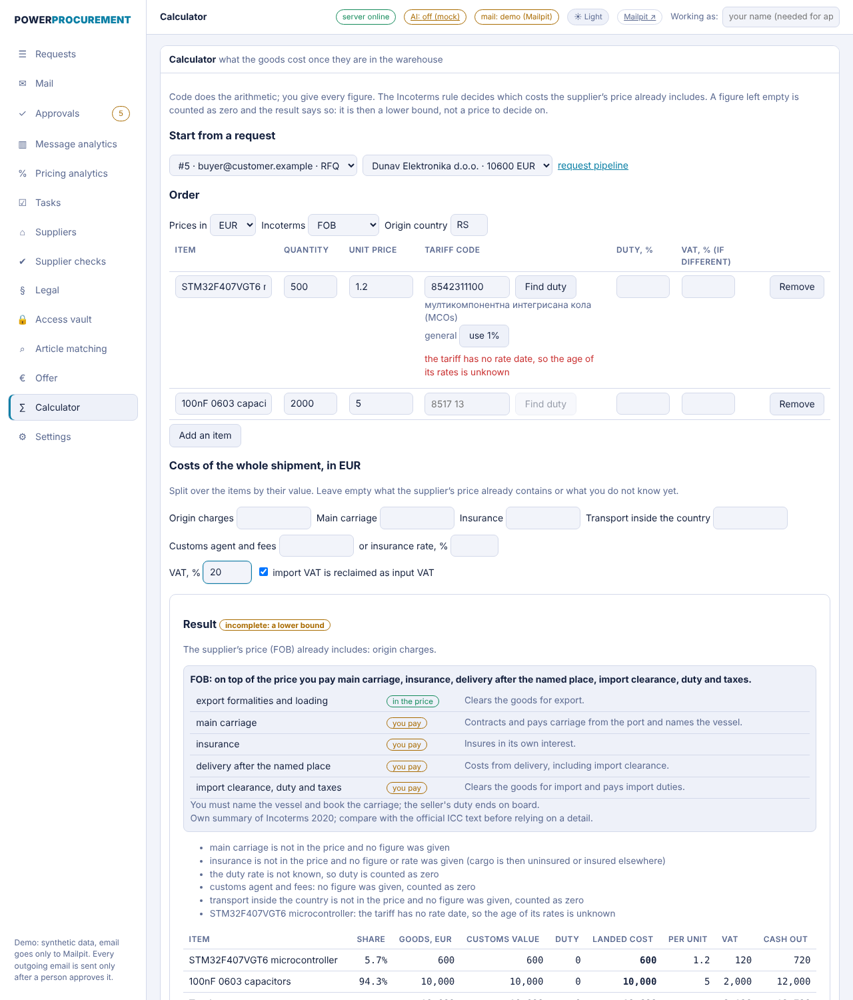

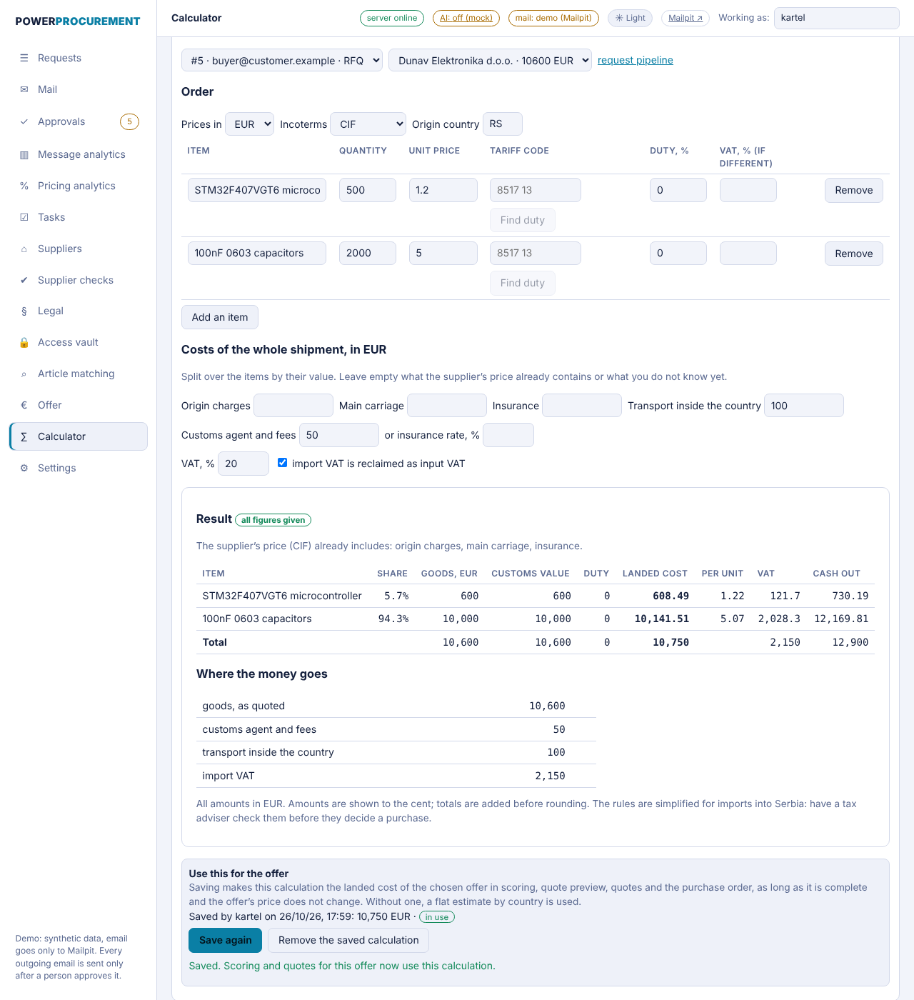

### Savings

A ledger of what the buyer's work saved, kept on a **Savings** tab. On each order a named person records a **baseline**: what the
goods would have cost without the work. Its basis is always stated: the dearest offer on the same request that covered every item,
the market target price (where prices were fetched), or an amount typed with a note saying where it comes from. For the first two
the amount is taken from the data at the moment it is set and kept, so later offers do not rewrite the ledger.

- **Negotiated saving** = baseline minus the offer behind the order (what was agreed).
- **Realized saving** = baseline minus the supplier's invoice, counted only once a person has **accepted** that invoice (see Supplier
  invoice under Step 8). The realized totals cover only those orders, and say how many were accepted with a difference.
- Goods without VAT, in EUR at the Settings rates. Freight and duty are not in this ledger. A negative figure is shown as it is.
- **Export to Excel** gives the rows and the totals. `GET /savings`, `GET /savings/export.xlsx`, `PUT/DELETE /orders/{id}/savings/baseline`.

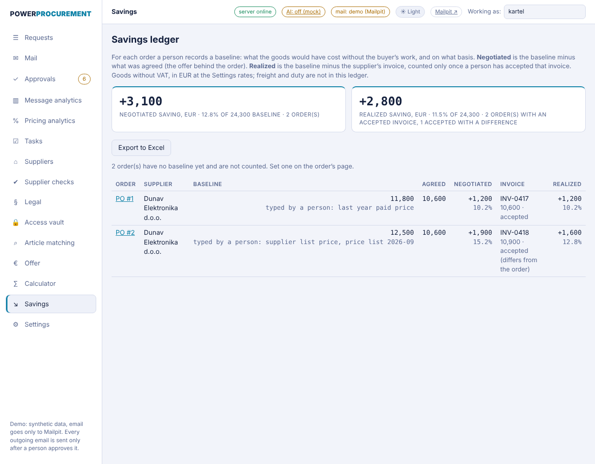

### Tasks (Bitrix24, Excel)

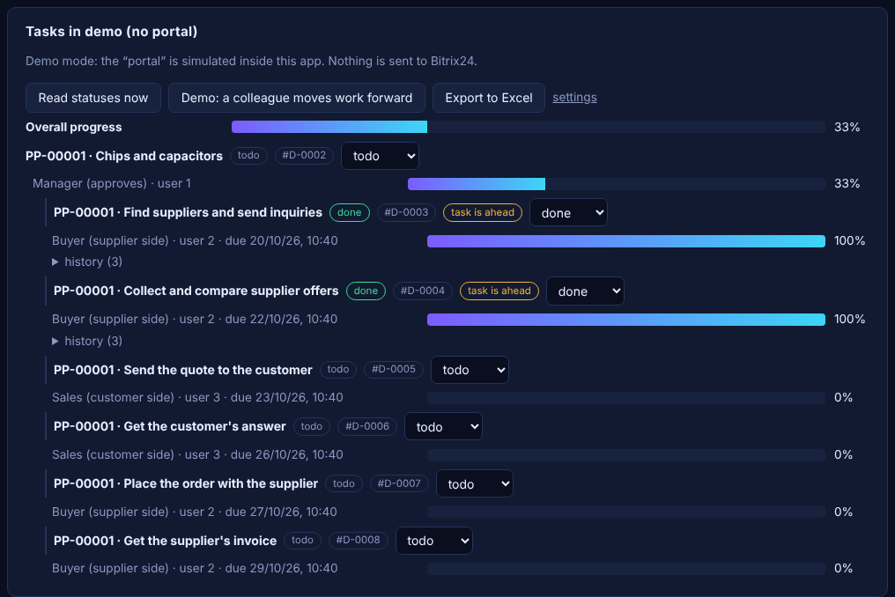

Each confirmed request can become a **task with subtasks** in Bitrix24: one parent task for the request, one subtask per step
(suppliers, offers, quote, customer's answer, order, invoice). The app then reads the statuses back, keeps the history of what
changed and when, and shows the **progress** of every task and of the whole request. A person presses **Create tasks**; nothing
is created on its own, and **no AI is involved** in this part: the plan, the progress and the warnings are computed by code.

Three modes, chosen on the **Tasks** tab:

- **Bitrix24 (API).** Cloud Bitrix24 through an *incoming webhook* (Developer resources, Other, Incoming webhook; give it the
  Tasks and Users permissions). Paste its address once; it is stored encrypted like the AI key. **Test the connection** and
  **Load people, groups and stages from the portal** fill the dropdowns below with your own people and stages.
- **Excel file only.** No connection. **Export** gives a list of tasks; update the statuses in Excel or in Bitrix24
  (*Export to Excel* there) and **import** the file back. Rows are matched by the Bitrix24 task number, or by request and key.
  Status words in any language are understood (`Завершена`, `In progress`, `done`, ...); add your own words in the settings.
- **Demo.** A simulated portal kept inside the app, so every feature can be shown without a Bitrix24 account. It says so on screen.

**Two Bitrix24 portals are never alike, so nothing company-specific is in the code.** One saved document holds it all:

| Setting | What it decides |
| --- | --- |
| People and roles | Which portal user each role (sales, buyer, manager, any you add) maps to; who is the author; who is responsible by default |
| Statuses | What each of your status codes means (`new / in progress / review / done / paused`); kanban stages can be mapped too and win over the code |
| Steps | Which steps become tasks, their titles and descriptions (`$ref`, `$subject`, `$customer`, `$items`, `$needed_by`), parent, role, due in N days, checklist, and at which request stage the step should be finished |
| Custom fields | Which of your `UF_` fields carries the request number, customer and so on; fixed extra fields (priority, tags) |
| Actions | Which Bitrix24 method sets each state when a person changes it from here |
| Everything as JSON | The same document, to copy to another installation or to a customer |

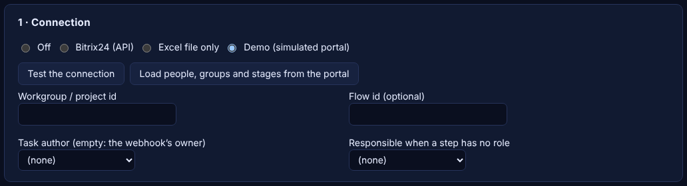
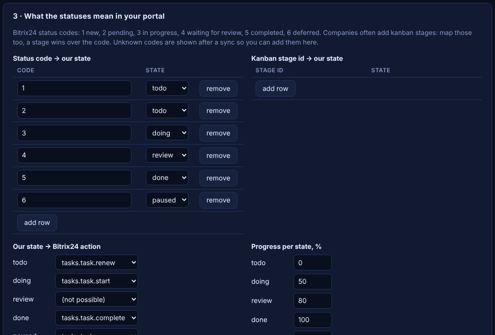
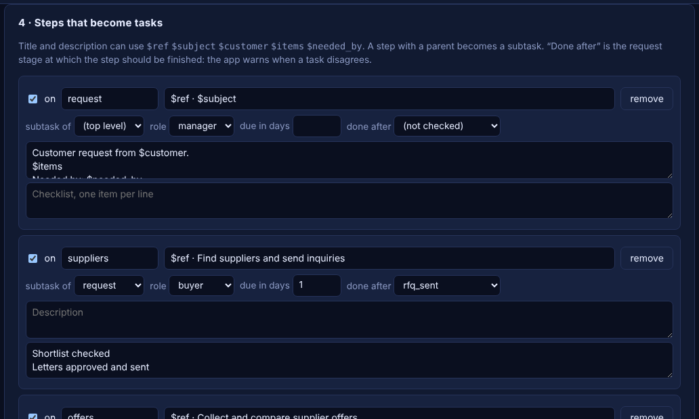

After each sync the page lists **status codes it did not understand** so you can add them to the map, tasks **deleted in the portal**,
and **drift**: a task still open although the request is past that step, or a task closed before the app shows the step done.
Bitrix24 stays the source of truth for status; changing a state here calls the matching Bitrix24 method and is recorded with your name.

#### Step by step: connect Bitrix24

1. **In Bitrix24** (cloud): open *Developer resources* → *Other* → *Incoming webhook* and create one. Tick the permissions
   **Tasks (task)** and **Users (user)**; add **Workgroups (sonet_group)** if your tasks live in a workgroup or project.
   Copy the address. It looks like `https://your-company.bitrix24.com/rest/1/xxxxxxxxxxxx/`. The webhook acts as the user who
   created it, so create it under the account that should appear as the task author (or set an author below). Bitrix24 REST needs a paid plan.
2. **In PowerProcurement:** enter your name at the top, open the **Tasks** tab, choose **Bitrix24 (API)** and press **Save all settings**.
3. Paste the address under *Incoming webhook* and press **Save address** (stored encrypted, shown only as its last four characters).
4. Press **Test the connection**: it answers "Connected to ... as <your name>". An error is explained in words (wrong address,
   missing permission, rate limit).
5. Press **Load people, groups and stages from the portal**. The person fields become dropdowns of your real users.
6. **People and roles:** pick a portal user for each role (sales, buyer, manager, or roles you add). Pick the workgroup id if you use one,
   the author (leave empty for the webhook's owner) and a default responsible. Bitrix24 refuses a task without a responsible user, so the
   app refuses before sending anything and says which step has nobody.
7. **Statuses:** check the status table. The starting values are Bitrix24's standard codes (1 new, 2 pending, 3 in progress, 4 waiting for
   review, 5 completed, 6 deferred). If your portal uses kanban stages, add `stage id → state` rows; a stage wins over the code.
8. **Steps:** switch steps on or off, rename them, change the parent, role, due days and checklist. Press **Save all settings**.
9. Open a **confirmed request**. The *Tasks* panel shows the plan; nothing exists yet. Press **Create 7 tasks**. Parents are created first.
   If something fails midway, what was made stays and the next press continues.
10. Later, press **Read statuses now** (on the request, or on the Tasks tab for all requests). The panel shows each task's status, responsible,
    deadline, history and progress. If a status code is unknown, the message names it: add it under *Statuses* and read again.

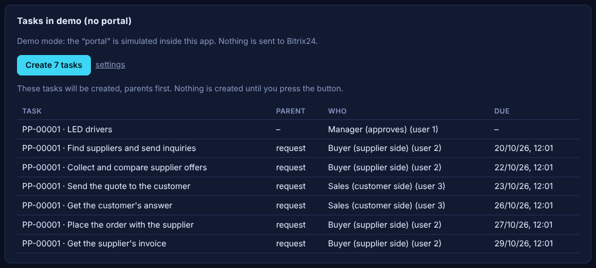

#### Step by step: Excel mode (no connection)

1. On the **Tasks** tab choose **Excel file only** and save.
2. On a request press **Create tasks**: the tasks exist in the app only (no task number yet).
3. Press **Export to Excel** (on the request, or *Export all tasks to Excel* on the Tasks tab). The file has the columns
   Request, Key, Task, Parent key, Role, Responsible, Creator, Deadline, Status, Remote status, External ID, Link.
4. Work in the file or in Bitrix24, then change the **Status** cells (our words `todo / doing / review / done / paused`, or Bitrix24's own
   such as `In progress`, `Завершена`).
5. On the Tasks tab choose the file under **Import statuses from Excel**. The result says how many rows changed, were unchanged, were not
   found, and lists status words it did not understand. A file exported from Bitrix24 itself works too, matched by its task number column (`ID`).

#### Step by step: try it without Bitrix24

Choose **Demo (simulated portal)**, save, open a confirmed request and press **Create tasks**. The button **Demo: a colleague moves work
forward** advances the first open tasks one status at a time and **Read statuses now** shows what changed, so you can see history, progress
and the "task is ahead / behind" warnings. Demo mode never contacts Bitrix24 and says so on screen.

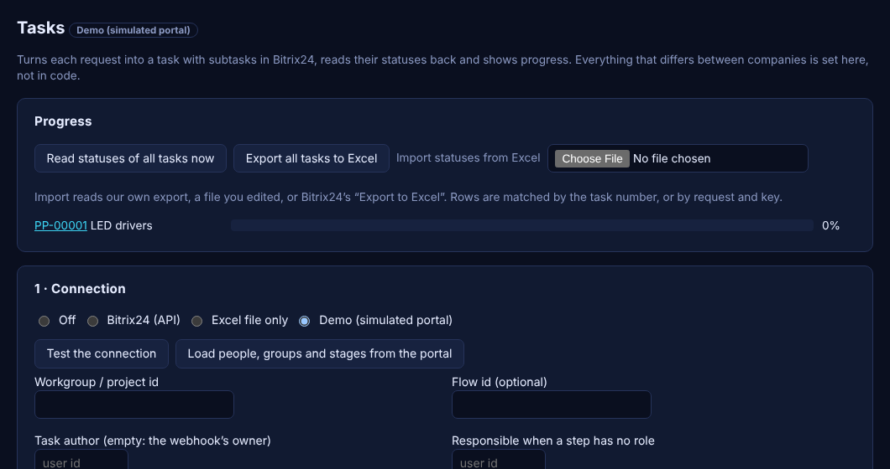

#### Fitting it to your company

- A different workflow? Change the **Steps** (add, remove, re-parent, rename) and the status map. No code change.
- Tasks in a flow or a project? Set the group id or flow id; any other Bitrix24 field (priority, tags, a custom `UF_` field for the
  request number) goes under *Custom fields and Excel columns*.
- Another language or other status words in Excel? Add them in *Everything as JSON* under `excel.status_words`.
- Several installations or customers? Copy the JSON from one Tasks tab and save it on another.

Honest limits: this was written from Bitrix24's public REST documentation and tested against a scripted portal, **not against a
live Bitrix24 account**. Exact field names for flows (`FLOW_ID`), custom fields and kanban stages may need a small change on your
portal, which is why they are settings. Statuses are read by polling (a "Read statuses now" button), not by Bitrix24 events.
Bitrix24 REST needs a paid plan and allows about 2 requests per second; the client waits and retries when told to slow down.

### Legal (contract review)

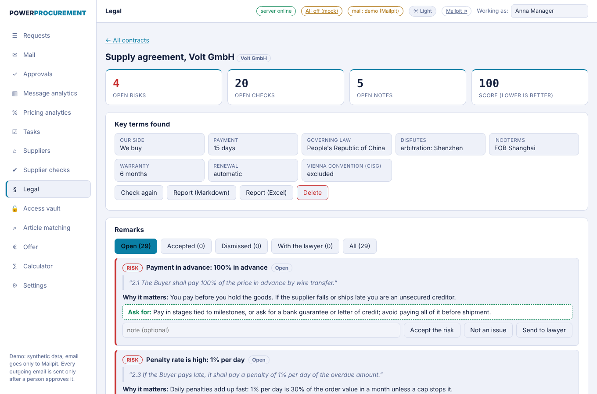

Paste or upload a contract (`.docx`, `.pdf`, `.txt`) and the **Legal** tab reads it, pulls out the key terms and flags what a manager
or lawyer should look at. It works from **our side**: choose *We buy* (the other party is our supplier) or *We sell* (the other
party is our customer), because the same clause can be a risk for one side and good news for the other (100% payment in advance is
a risk when we buy and a safeguard when we sell). **It is a first screening, not legal advice.**

**Who does what.** Code finds the clauses and facts and decides what is a risk (about 38 checks in `backend/app/legal/playbook.py`:
payment term and advance, penalty rate and cap, liability caps, warranty and claim periods, automatic renewal, one-sided termination
or assignment, governing law and forum, the Vienna Convention (CISG), Incoterms, retention of title, data protection, sanctions,
force majeure, confidentiality, and for software and subscriptions data exit and service levels). The AI is optional and only adds
extra remarks, per contract and on request. **A person decides** on every remark.

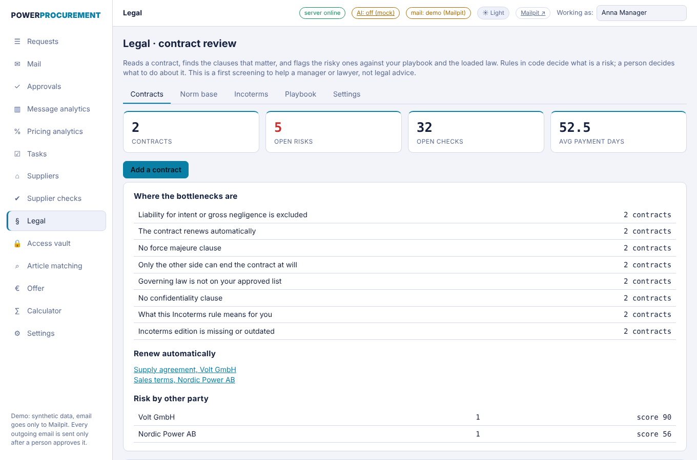

**Step by step**

1. Type your name at the top (decisions are recorded with it).
2. *Contracts*, **Add a contract**: title, other party, our side, optional request number and end date; paste the text or choose a file.
   Press **Review the contract**.
3. The contract page shows the key terms found (payment days, law, forum, Incoterms, warranty, renewal, CISG) and the **remarks**,
   risks first. Each remark has the exact words of the contract in quotation marks, **why it matters**, **what to ask for**,
   and the law it rests on. Press **Accept the risk**, **Not an issue** or **Send to lawyer**; a note is optional. **Check again**
   re-reads the text and keeps your decisions.
4. **Report (Markdown)** or **Report (Excel)** downloads the review. The *Contracts* tab shows all contracts, the bottlenecks that
   repeat across them, contracts ending in 90 days, automatic renewals and the average score by other party.
5. Linking a contract to a request number shows it on that request.

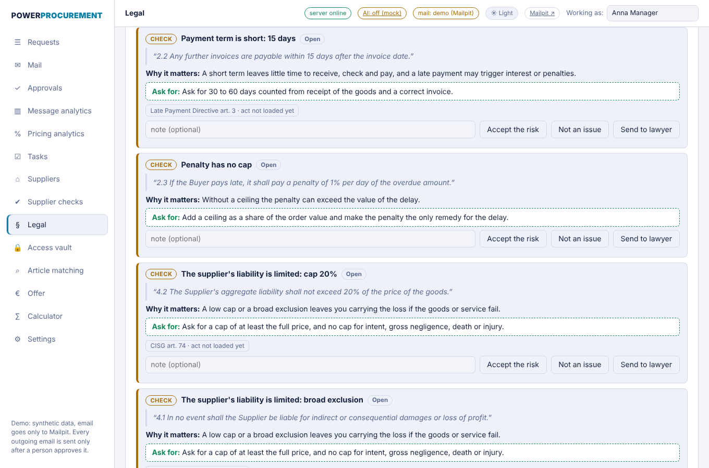

**The law references.** Each remark names an act and an article (for example Late Payment Directive art. 3, CISG art. 74). The
reference is checked against the **norm base**: *found in the loaded text*, *act loaded, article not found*, or *act not loaded yet*.
The repository does not ship any statute text. Fill the base on the **Norm base** tab:

- **Load** fetches an act by itself: the 27 EU acts from the EU Publications Office (then EUR-Lex), and the CISG, the New York
  Convention and the UNIDROIT Principles from the PDF their publisher (UNCITRAL, UNIDROIT) offers. The server needs internet access
  to `publications.europa.eu`, `eur-lex.europa.eu`, `uncitral.un.org` and `www.unidroit.org`. For an EU act the loader asks for
  the **newest consolidated version in force** and falls back to the text as first published only when no consolidated version
  exists; the version used is shown in the act's note. (The plain text of an amended act is outdated law: Regulation 833/2014 on
  sanctions against Russia has 15 articles as first published and 111 in the consolidated text.)
- **Upload** takes a file you saved from the official site (HTML, PDF, Word or text). The national laws of **Serbia, China and the
  UAE have no automatic download**: upload them here (check the act name first, they are marked), or when a site shows a browser
  check to a program.
- On the server: `python -m app.legal.loader --fetch eu-2011-7 eu-2016-679`, `python -m app.legal.loader --all` (every act that has
  a download address, 30 of the 53; about 40 seconds), or `python -m app.legal.loader --dir ./saved` (files named like the act
  keys, `rs-zoo.pdf`, `eu-2011-7.html`).

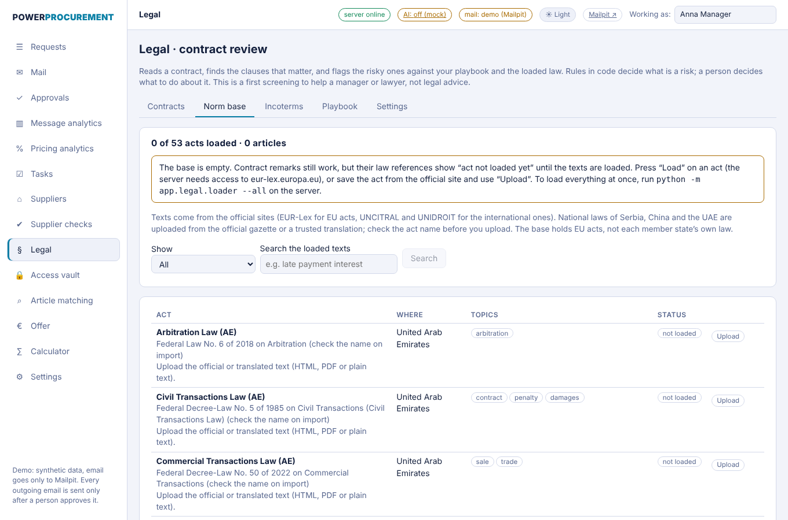

*The screenshot shows the base before the first load.* After `--all` the 30 acts with a download address read *loaded* with their
article counts (27 EU acts 1,550 articles, CISG 101 plus a preamble entry, New York Convention 16 plus a preamble entry, UNIDROIT Principles 210 plus a
preamble entry) and the 23 national acts read *not loaded*. Articles are numbered as the act numbers them (`12a`, `1.1`, Roman
`iv`).

The base holds 53 acts: EU rules on late payment, consumer sales and digital content, e-commerce and services, copyright, product
safety and liability, the Cyber Resilience Act, data (GDPR, Data Act), AI Act, sanctions and others; CISG, the New York Convention and
the UNIDROIT Principles; and the commercial, civil and arbitration laws of Serbia, China and the UAE. It holds EU acts, **not each
member state's own law**, and no case law.

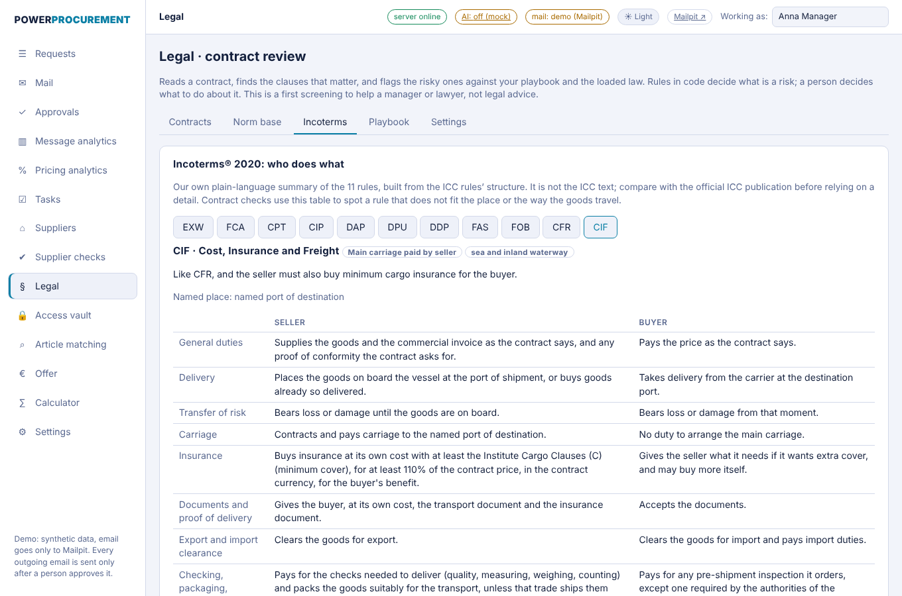

**Incoterms®.** The *Incoterms* tab is our own plain-language summary of the 11 rules of the 2020 edition, in ten topics (delivery, risk,
carriage, insurance, documents, clearance, checking, costs, notices) and a note for each side, plus what Incoterms do not cover
(ownership, price, remedies, force majeure, law and court). It is not the ICC text; compare with the official publication before
relying on a detail. The contract checks use it to flag a rule without a named place, an outdated rule (DAT, DAF, DDU...), a
sea-only rule for other transport, two different rules in one contract, or a missing edition.

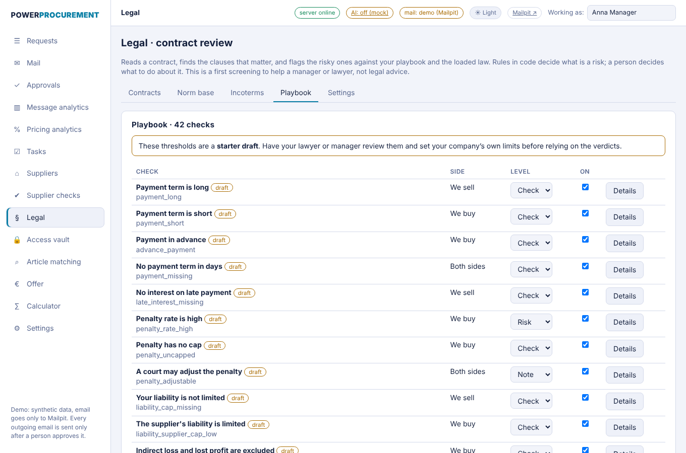

**The playbook and company settings.** The *Playbook* tab lists every check with its level (*Risk*, *Check*, *Note*), an on/off switch,
the thresholds, the "why it matters" and "what to ask for" texts. **The starter values are a draft** written without a lawyer; a check
keeps its *draft* tag until someone saves it after review. *Settings* holds the governing laws and forums your company accepts, the
score weights (the score is the weighted count of open remarks; lower is better) and an optional **sign-off rule**: when on, the
purchase order of a request is refused while a contract linked to it has an open risk.

**AI reading.** Off by default. Tick *Allow the AI to read this contract*, and the page shows how many characters would be sent; the
text leaves the server only when you press **Ask the AI** (with an Anthropic key set). The AI only adds remarks; every quote it gives is
checked against the contract text and wrong ones are dropped. Contract text is treated as untrusted input.

**What was checked on 2026-10-19.** The loader was run once against the live EU Publications Office, UNCITRAL and UNIDROIT. All 27
CELEX numbers in the catalogue were compared with the title in the text returned (all matched). The starter playbook has 42 rules
with 39 law references: **30 resolve to an article that exists in the loaded text, none points at a missing article, and 9 name
Serbian, Chinese or UAE acts that are not loaded**. "Exists" means the article number is there, not that a lawyer confirmed the
article says what the remark claims.

Honest limits: the 23 national acts (Serbia, China, UAE) are not loaded and their catalogue names and numbers are still unconfirmed;
article counts and spot reads were checked, not every word of every act; laws change, so load again to refresh (the base is a snapshot
with the date and hash of each load); the text of the acts comes from the official sites and is the user's to load, the repository
ships none; English contracts only; scanned PDFs without a text layer are not read (no OCR); it does not know your company's history with a party.

### Settings


- **AI (Anthropic Claude).** Provider (`mock` or `anthropic`), model, and your API key with **Save**, **Test key**
  (one 8-token call, reports the result in plain words) and **Remove key**. See [Turning on the AI](#turning-on-the-ai).
- **Exchange rates.** Choose *National Bank of Serbia (middle rate)* or *Manual* with the RSD and USD per 1 EUR
  numbers. **Fetch from NBS now** reads the current rate on demand; with NBS selected the app refreshes about every
  six hours, keeps every fetched rate with its date and keeps the last good one when a fetch fails. The bank
  itself has no free JSON feed, so the app reads the public mirror `kurs.resenje.org`; the address is itself a setting.
- **Customs duties.** A registry of the lines of an official customs tariff: the general duty, the unit and the rates
  under the trade agreements (SSP with the EU, CEFTA, EAEU and EFTA by country, TR, GB, CN, AE, EG), searchable by code
  or words, with the tariff's name and date and who loaded it. For a code and an origin country it shows the general and
  the preferential rate side by side; a preference needs proof of origin, so it is never applied for you. A rate that is
  not a plain percentage (a table reference, a minimum, a sub-case) is kept as printed and marked "needs a look". The Settings tab also holds the limit after which a tariff's rates count as old (calculations then warn). Nothing
  is typed from memory and no tariff ships with the app: load the official PDF with
  `cd backend && uv run python -m app.duty.loader --pdf tariff.pdf --source "Customs Tariff 2026" --by "your name" --csv-out tariff.csv`
  (about a minute and a half for 1,750 pages; written against the Serbian Customs Tariff 2026 layout) or load the saved CSV
  here. Loading replaces the whole registry. Keep the PDF and the table out of git.

### Mailpit (demo inbox)

Every email the app "sends" (supplier letters, quotes, purchase orders, invoice requests) is caught by
[Mailpit](https://mailpit.axllent.org/) at http://localhost:8025. Open it to see exactly what a supplier or customer
would have received.


## How the numbers are computed

Everything below is code you can read (`backend/app/scoring`, `backend/app/pricing`, `backend/app/quotes`). AI never
changes a number.

**Landed cost.** Goods price in EUR, plus a demo model of freight and duty as a share of goods value by supplier
country: RS 3%, DE/PL/HU 5%, TR 12%, CN 18%, any other country 10%. These are proposals, not real tariffs. This flat
estimate is only the fallback: an offer with a complete saved Calculator calculation is judged by that instead, and the
score table says which one it used.

**Hard filters.** A sanctioned supplier and an offer that does not cover every requested item are excluded before
scoring and shown last with the reason. Suppliers whose newest check says *not working* never reach the shortlist.

**Score** = weighted sum of five criteria, each 0 to 100 (a sixth, delivery history, is off until it gets a weight in Settings). Default weights are 30 / 20 / 20 / 15 / 15 and you can
change them with the sliders on every request (they are normalised, so only the proportions matter).

| Criterion | Default weight | How it is scored |
| --- | --- | --- |
| Price | 30 | 100 × (target or best landed cost) ÷ this offer's landed cost |
| Lead time | 20 | 100 if within the days available; otherwise minus 10 points per late day (without a deadline: 100 minus the lead days, at most 60 off) |
| Reliability | 20 | 10 + 4 per year in business (up to 10) + 20 if the VAT ID is verified + 2 per past deal (up to 15), minus penalties for flags such as an unverified tax ID |
| Terms | 15 | 30 for a framework contract + up to 30 for payment days (60 days = full) + up to 25 for warranty (24 months = full) + 15 if the MOQ fits |
| External risk | 15 | 100 minus a country penalty (RS 5, DE/PL/HU 0, TR 15, CN 20, other 10) minus penalties for flags such as reported customs delays |
| Delivery history | 0 (off) | Share of the supplier's delivered orders that came on time, averaged over the date in force and the first date (0 to 100). Weight and minimum are set in **Settings, Scoring**; used only for a supplier with at least that many delivered orders that had a promised date (3 by default), otherwise left out for that supplier and the ranking says so |

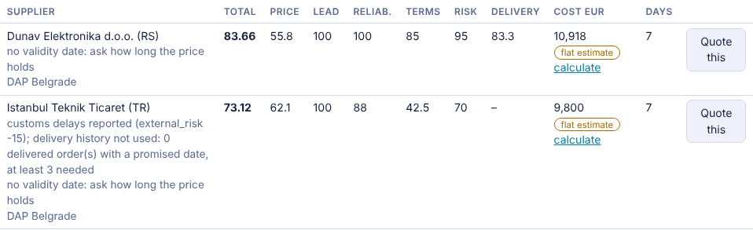

**Quote.** Customer price = landed cost × (1 + markup), converted at the bank rate. The preview shows cost, price
and margin before anything is created.

**Markup hint.** Pricing analytics groups quotes by markup bucket, counts how often they were accepted, fits a
win-rate curve and suggests the markup that maximises expected margin (markup × win rate). It uses the narrowest group with
enough quotes (the customer's own history, then the category, then all quotes) and always says which one.

**Purchase order checks.** Only after the customer **accepted**; the cost must be within `PO_BUDGET_LIMIT_EUR`
(50,000 EUR by default); the agreed price must not be below cost; one order per request. The order then gets its delivery record (see Step 8).

**Supplier invoice.** On each order a person can type in the supplier's invoice (number, date, currency, total without VAT, VAT,
and optionally the lines). Code compares it with the offer behind the order: the total, and with lines each item's quantity
(exact) and unit price, items missing from the invoice, and whether the lines add up. A gap up to the tolerance in **Settings,
Supplier invoices** (1% by default) counts as a match; anything else is listed in words. A person accepts the invoice, with a
reason when it differs; an accepted invoice is frozen. Nothing is paid or posted from here, and VAT is shown but not checked.

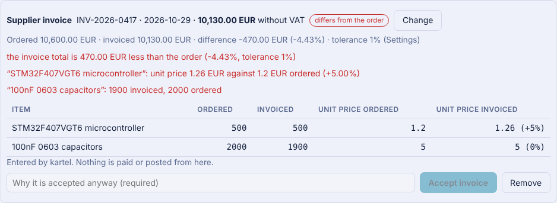

**Invoices that differ.** The Requests page lists every invoice that differs from its order, largest amount first, with what
differs: *total*, *unit price*, *quantity*, *missing item*, *lines don't add up*, *unknown line* and *duplicate number* (the same
supplier already has an invoice with that number on another order; case, spaces and dashes are ignored, so `INV-2026/7` and
`inv 2026 7` count as one). Filter by kind, and switch between invoices not yet accepted, accepted with differences, or all.
`GET /supplier-invoices/mismatches`. A different currency is only a note, not a difference.

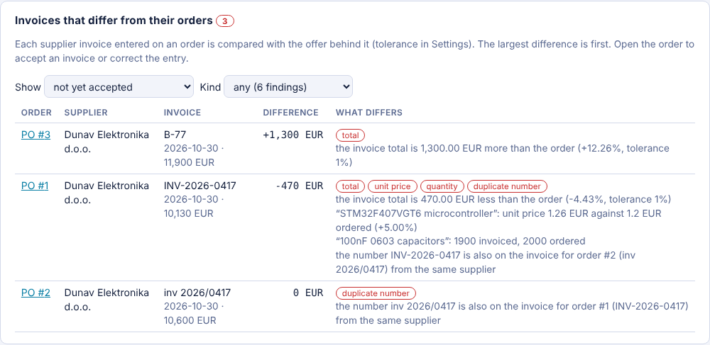

## Safe by default

- **Nothing is sent outside the machine.** All mail goes to Mailpit. Real sending is a separate flag
  (`MAIL_REAL_SEND_ENABLED`, off) and, when on, limited to the addresses in `MAIL_ALLOWED_RECIPIENTS`.
  Real sending is environment-only on purpose and cannot be switched on from the browser.
- **Every outgoing message needs a named human approver** (`backend/app/mail/sender.py`).
- **AI never decides numbers.** It extracts and explains. Answers are schema-validated and carry a confidence
  score; below the threshold (0.75 by default) the item goes to a person.
- **A person confirms every request** before any supplier is contacted.
- **Secrets are encrypted** before they reach the database (API key, vault entries) and are never sent back to
  the browser; logs and the audit trail never contain them.
- **Names are not sign-ins.** The top-bar name is an audit label. Run the app on a machine and network you trust,
  or put your own authentication in front of it, before storing anything real.
- **CI never calls the live Claude API.** It replays recorded answers (`backend/app/ai/replay.py`). Prompts are
  versioned files (`backend/app/ai/prompts/`).
- **Contracts stay on the server.** The Legal tab sends a contract to the AI provider only when the contract is marked *allow the AI*
  and a person presses **Ask the AI**; the page shows the size first.
- **Demo data is synthetic.** No real customers, suppliers, prices or emails. Forecasts shown on demo data say
  nothing about any real market.

## Turning on the AI

Optional. Without a key everything works on templates.

1. Open **Settings**, set *Provider* to `anthropic`, paste your own [Anthropic API key](https://console.anthropic.com/)
   and click **Save**, then **Test key**.
2. Set a spend limit in the Anthropic console first: calls are billed to your key.
3. That is all. The buttons that use the AI switch on: **Parse with AI** and **Parse all with AI** in Mail, extra suppliers and
   AI-written letters on the request page, **Read with AI** for supplier and customer answers, **Explain** buttons, follow-ups,
   reminders and invoice requests. Only these buttons spend tokens; the list is in [ground rules](#ground-rules-for-every-ai-step).
   Every one of them still works without a key, on a template or a hand-entry form.

The key is stored **encrypted** in the database; the encryption key is `APP_SECRET_KEY` or, if empty, a key generated
once into the `appdata` volume. It is never shown again and never goes back to the browser. A key saved in
Settings wins over `.env`. If you move the database to another machine, enter the key again.
Details: [ADR 0008](docs/decisions/0008-keys-in-app-and-nbs-rates.md).

### Parsing accuracy

16 synthetic gold emails (English, Serbian Latin and Cyrillic, German, and non-requests) live in
`backend/app/intake/gold/`. To measure the real model (a few cents; needs `ANTHROPIC_API_KEY` in the environment
or `.env`; keys saved in the Settings tab are used by the app, not by this command):

```bash
cd backend && AI_PROVIDER=anthropic uv run python -m app.intake.evaluate --live
```

The run records the answers, so later runs and CI replay them for free. **No accuracy figure is published here
until a live run has actually been made.**

## Configuration reference

Nothing is required. To change defaults copy `.env.example` to `.env` (never commit it). Values saved in the
Settings tab win over `.env`.

| Variable | Default | Meaning |
| --- | --- | --- |
| `POSTGRES_USER`, `POSTGRES_PASSWORD`, `POSTGRES_DB` | `powerprocurement`, `change-me`, `powerprocurement` | Database credentials for the compose database |
| `AI_PROVIDER` | `mock` | `mock` replays recorded answers; `anthropic` calls the live API |
| `AI_MODEL` | `claude-sonnet-5-5` | Model used for parsing and drafting |
| `AI_CONFIDENCE_THRESHOLD` | `0.75` | Extractions below this go to a person; AI pool suggestions below it are ignored |
| `FOLLOWUP_AFTER_DAYS` | `3` | Days without an answer before a supplier is offered a follow-up letter |
| `ANTHROPIC_API_KEY` | empty | Optional; you can enter it in Settings instead |
| `APP_SECRET_KEY` | empty | Fernet key that encrypts saved secrets; generated into the `appdata` volume if empty |
| `MAIL_REAL_SEND_ENABLED` | `false` | Real sending; off means everything goes to Mailpit |
| `MAIL_ALLOWED_RECIPIENTS` | empty | Comma separated allow-list used when real sending is on |
| `SMTP_HOST`, `SMTP_PORT`, `MAIL_FROM` | `mailpit`, `1025`, `procurement@demo.local` | Outgoing mail server and sender address |
| `IMAP_HOST`, `IMAP_PORT`, `IMAP_USER`, `IMAP_PASSWORD`, `IMAP_FOLDER`, `IMAP_SSL` | empty, `993`, ..., `INBOX`, `true` | Read a real inbox; leave empty in the demo |
| `FX_SOURCE` | `manual` | `nbs` for National Bank of Serbia middle rates |
| `FX_RSD_PER_EUR`, `FX_USD_PER_EUR` | `117.0`, `1.08` | Manual rates, units per 1 EUR |
| `DEFAULT_MARKUP` | `0.15` | Starting markup until analytics suggests one |
| `PO_BUDGET_LIMIT_EUR` | `50000` | Largest purchase order the system approves |

Reading a real inbox over IMAP and live Claude calls have not been exercised against real servers in this
repository's tests; both are covered by mocks and recorded answers.

## Architecture and repository layout

```
Browser ──> frontend (Next.js) ──/api──> backend (FastAPI) ──> Postgres
                                              │
                                              ├── ai/       one adapter: replay | recording | Claude API
                                              └── mail/     one sender: approval required, Mailpit by default
```

| Path | What lives there |
| --- | --- |
| `frontend/app/` | The panel: one folder per tab (`suppliers`, `checks`, `vault`, `quote`, ...), shared `components/` and `lib/` |
| `backend/app/intake/` | Email to structured request, gold set, evaluation |
| `backend/app/suppliers/` | Shortlist and supplier profiles, checks, sorting |
| `backend/app/pricing/`, `scoring/`, `quotes/`, `orders/` | Target prices, scoring formulas, markup and quotes, purchase orders |
| `backend/app/rfq/`, `mail/` | Letters, approval queue, the single mail sender, mailbox |
| `backend/app/analytics/` | Message analytics and markup analysis |
| `backend/app/vault/`, `runtime/` | Encrypted access vault; runtime settings, secret encryption, exchange rates |
| `backend/app/ai/` | The AI adapter, versioned prompts, the one `run_task` helper every assisted step calls |
| `backend/app/legal/` | Legal: act catalogue, loader, Incoterms data, clause analysis, the playbook, reports, API |
| `backend/app/duty/` | Customs duty registry: tariff parser, loader, search, rates for an origin |
| `backend/app/worktasks/` | Tasks in Bitrix24 / Excel / demo: saved settings, providers, plan, status sync, progress, Excel in and out |
| `backend/app/assist/` | The assisted steps: supplier pool, letter drafts and their checks, supplier replies, follow-ups, explanations |
| `backend/migrations/` | Alembic migrations (0001 to 0021) |
| `docs/` | [Architecture](docs/architecture.md), [how the AI was directed](docs/ai-workflow.md), [decision records](docs/decisions/) |

Everything that talks to the outside world sits behind an adapter so it can be swapped or faked without touching
business logic. The rules above are enforced in code and covered by tests.

## Develop and test

Without Docker for the app itself (needs Python 3.12+, [uv](https://docs.astral.sh/uv/), Node 22 and a Postgres):

```bash
docker run -d --name pp-db -e POSTGRES_USER=pp -e POSTGRES_PASSWORD=pp -e POSTGRES_DB=pp -p 5432:5432 postgres:16-alpine
cd backend && uv sync
export DATABASE_URL=postgresql+psycopg://pp:pp@localhost:5432/pp
uv run alembic upgrade head && uv run python -m app.seed
uv run uvicorn app.main:app --port 8000                                       # API
cd ../frontend && npm ci && BACKEND_URL=http://localhost:8000 npm run dev     # panel on :3000
```

Checks, the same as CI (`.github/workflows/ci.yml`):

```bash
cd backend
uv sync
uv run ruff check . && uv run ruff format --check .
uv run alembic upgrade head && uv run pytest        # integration tests need DATABASE_URL (Postgres)
cd ../frontend && npm ci && npm run lint && npm run build
```

The backend suite has 156 tests (pipeline end to end, scoring, mail guard, settings, profiles and vault, analytics, the AI steps, file reading, order letters, the pre-release fixes, the task integration and the legal module with its loader and article parser, with scripted models and pages).
What a run looks like (real output, Postgres 16; the AI steps are tested with a scripted model, not the live API):

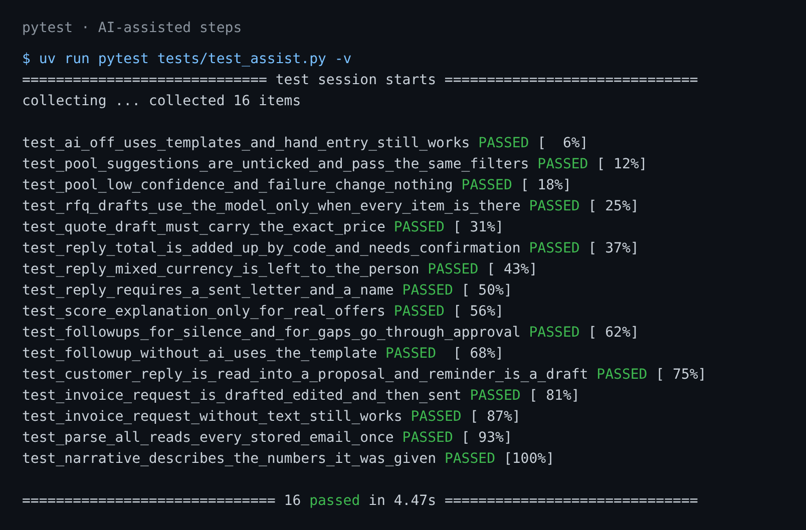

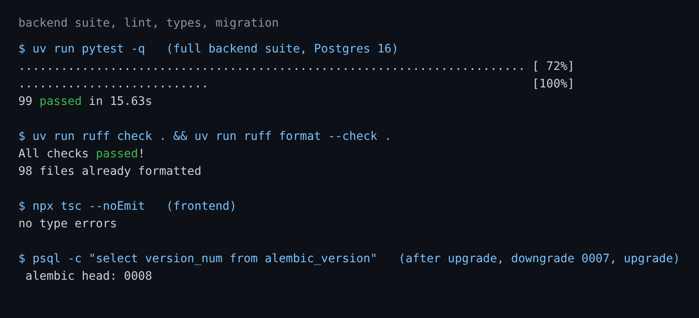

To see mail from a local run, start [Mailpit](https://mailpit.axllent.org/) on ports 8025 and 1025.

## Troubleshooting

| Problem | What to do |
| --- | --- |
| Buttons are greyed out | Type your name in *Working as* at the top |
| `port is already allocated` | Stop whatever uses 3000, 8000 or 8025 and run `docker compose up` again |
| The panel says *server unreachable* | The backend is still starting; wait for the compose log to show it healthy, then reload |
| *Parse with AI* is missing, or the *Explain* buttons are greyed out | AI is off: open Settings, choose `anthropic`, save a key |
| *Test key* says the key was rejected | Check the key in the Anthropic console; the app shows a plain reason (rejected, no access, model not found, rate limit, no network) |
| Vault says an access *cannot be decrypted* | The encryption key changed (new `APP_SECRET_KEY` or wiped volume); enter that access again |
| *Fetch from NBS now* fails | The rate mirror is unreachable from your network; the last good rate stays in use, or switch to *Manual* |
| Start over from scratch | `docker compose down -v`, then `docker compose up --build` |
| Tasks: *paste the Bitrix24 webhook address first* | Choose Bitrix24 (API) and save the address on the Tasks tab |
| Tasks: *the webhook may not use tasks* | Edit the webhook in Bitrix24 and tick the Tasks and Users permissions |
| Tasks: *has nobody responsible* | Give each role a user, or set a default responsible, on the Tasks tab |
| Tasks: *Unknown statuses* after reading | Add those codes (or kanban stage ids) to the status table and read again |
| Tasks: Excel import says *no status column* | The header row needs a status header name (default `Status` or `Статус`) |
| Legal: *Load* says the site asked for a browser check, or *refused (403)* | Save the act from the official site in a browser and use **Upload**, or allow the server to reach `publications.europa.eu`, `eur-lex.europa.eu`, `uncitral.un.org` and `www.unidroit.org` |
| Legal: an EU act shows *Text as first published* in its note | No consolidated version exists for it (typical for acts never amended); nothing to do |
| Legal: a national act (Serbia, China, UAE) will not load | It has no download address by design; save the official text and **Upload** it, or put it in a folder as `rs-zoo.pdf` and run `python -m app.legal.loader --dir <folder>` |
| Legal: every reference reads *act not loaded yet* | The norm base is empty; load the acts on the **Norm base** tab |
| Legal: the AI button is missing | Tick *Allow the AI to read this contract* on that contract and set an Anthropic key in Settings |
| Legal: *no text was found in the file* | A scan has no text layer; use a text version or paste the text |

## Roadmap

Each phase ends with an acceptance check; the next one starts only after it passes.

| Phase | Scope | Acceptance |
| --- | --- | --- |
| 0 | Scaffold: Docker, CI, database, AI adapter | `docker compose up` works, CI green (**done**) |
| 1 | Intake and parsing (step 1) | Parsing accuracy measured on a gold set of sr/en emails (**harness done, live measurement pending**) |
| 2 | Suppliers and prices (steps 2-3) | Shortlist and target prices for demo requests in three categories (**done on synthetic data; CSV price-list import; supplier profiles, checks, sorting; exchange rates from the National Bank of Serbia; live price sources pending**) |
| 3 | RFQ and approval queue (step 4) | Letters go through the approval queue into Mailpit (**done; letters are drafted by the AI when a key is set, otherwise from templates**) |
| 4 | Offers and scoring (step 5) | Comparison table; scoring covered by tests (**done**) |
| 5 | Customer quote and outcome (steps 6-7) | Quote passes markup approval; outcome recorded (**done**) |
| 6 | Order and invoice request (step 8) | End-to-end: email, quote, PO, invoice request (**done; the AI steps (supplier answers, follow-ups, reminders, invoice request) work as soon as a key is set, not yet run against the live API**) |
| 7 | Analytics and markup | Test recovers patterns planted in the synthetic data (**done; real outcomes will replace synthetic ones**) |
| 8 | Publication | README, demo GIF, AI work log; runs in a minute (**README and install done; demo video pending**) |

Also done: encrypted access vault, dark / light theme, task integration for Bitrix24 (built from the documentation, not yet run against a live portal), Legal contract review (the norm base is filled by the loader: 30 of 53 acts have been loaded and checked, the 23 Serbian, Chinese and UAE acts wait for files; no statute text ships with the repository). Not built: roles and sign-in, live price sources.

More: [architecture](docs/architecture.md) · [how AI was directed](docs/ai-workflow.md) ·
[decision records](docs/decisions/)

## License

[MIT](LICENSE)
