# PowerProcurement

[](https://github.com/KartelSRBX/PowerProcurement/actions/workflows/ci.yml)
[](LICENSE)

**From a customer's request email to an approved purchase order.** The app turns a request email into a
supplier-offer comparison, a customer quote with a markup, and a supplier purchase order. AI does the routine
work (reads the email, drafts letters, extracts terms from supplier replies). **A human approves every action
that leaves the system.** Scoring, prices and margins are plain deterministic code, never AI.

> **Status: working end to end, AI steps not measured yet.** The whole path runs on synthetic data and templates
> with **no AI and no outside accounts**: request, suppliers and target prices, letters with approval, offers and
> scoring, customer quote with markup, outcome, purchase order, invoice request. The AI steps (email parsing,
> drafting, extraction) have their interfaces, a gold set and an in-app key field, but their accuracy is
> **not published until a live run has been made** (see [Parsing accuracy](#parsing-accuracy)).

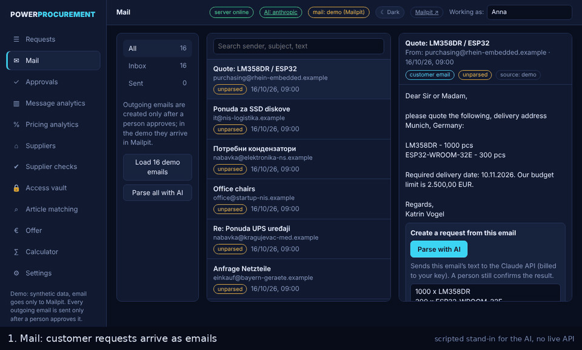

## Contents

1. [What it does](#what-it-does)
2. [Install and run](#install-and-run)
3. [First five minutes](#first-five-minutes)
4. [The panel, tab by tab](#the-panel-tab-by-tab)
5. [How the numbers are computed](#how-the-numbers-are-computed)
6. [Safe by default](#safe-by-default)
7. [Turning on the AI](#turning-on-the-ai)
8. [Configuration reference](#configuration-reference)
9. [Architecture and repository layout](#architecture-and-repository-layout)
10. [Develop and test](#develop-and-test)
11. [Troubleshooting](#troubleshooting)
12. [Roadmap](#roadmap) · [License](#license)

## What it does

A trading or procurement desk gets a request ("500 pcs of this microcontroller and 2000 capacitors") and has to
find suppliers, ask for prices, compare answers, quote the customer and place the order. PowerProcurement keeps
that whole path in one place, in eight steps:

| Step | What happens | Who does it |
| --- | --- | --- |
| 1. Request | An email becomes a structured request (items, quantities, category, language, deadline) | AI proposes (or you type it), **a person confirms** |
| 2. Suppliers | Suppliers that cover the items, are not sanctioned and did not fail their latest check are shortlisted | Code |
| 3. Target prices | Price lists give a target price per item, converted to EUR with the bank rate | Code |
| 4. Letters | Supplier letters are drafted in the supplier's language; **nothing is sent until a person approves** | Template or AI drafts, **a person approves** |
| 5. Offers | Supplier answers are compared and scored on price, lead time, reliability, terms and external risk | Code (weights are yours) |
| 6. Quote | Customer price = cost × (1 + markup), with a live margin preview and a markup hint from history | Code, **a person approves** |
| 7. Outcome | The customer's answer (accepted, rejected, counter-offer, silence) is recorded and feeds analytics | A person |
| 8. Order | Purchase order and invoice request, after the customer accepted and the budget checks pass | **A person approves** |

On top of that sit a mailbox, one approval queue, analytics, supplier profiles with due-diligence checks, an
encrypted access vault and a settings page where you enter your own API key.

## Install and run

You need **[Docker](https://docs.docker.com/get-docker/) with Compose** and about 2 GB of free disk. Nothing else:
no Python, no Node, no database to install, no account, no `.env` file.

```bash
git clone https://github.com/KartelSRBX/PowerProcurement.git
cd PowerProcurement
docker compose up --build
```

The first start builds the images (a few minutes) and fills the database with **synthetic** demo suppliers.
When the log shows the frontend as healthy, open:

| What | Where |
| --- | --- |
| Web panel | http://localhost:3000 |
| Demo inbox (Mailpit), every outgoing email lands here | http://localhost:8025 |
| API health | http://localhost:8000/health/ready |
| API reference (interactive) | http://localhost:8000/docs |

**Stop and clean up**

| Command | Effect |
| --- | --- |
| `Ctrl+C` in the terminal | stops the containers |
| `docker compose down` | removes the containers, **keeps your data** |
| `docker compose down -v` | also wipes the database and the saved encryption key (a fresh start) |
| `docker compose up -d` | runs in the background |

If a port is taken, stop the program using 3000, 8000 or 8025 first. Windows and macOS: run the commands in a
terminal while Docker Desktop is running (on Windows, WSL 2 is the usual backend).

> Nothing leaves your machine. All outgoing email goes to Mailpit, the demo data is invented, and AI is off until
> you paste a key.

## First five minutes

1. Open http://localhost:3000. At the top right, type **your name** in the *Working as* box. Every approval and
   edit is recorded under it, and most buttons stay disabled until a name is there.
2. Open **Mail**, click **Load 16 demo emails**, pick an email and click **Confirm as request**.
   (Or use **Requests → Create request**, which comes with a sample prefilled.)
3. On the request page click **Find suppliers and prices**, then **Draft letters**.
4. Open **Approvals**, read a letter, edit it if you like and click **Approve and send (to Mailpit)**.
   The email appears in Mailpit at http://localhost:8025.
5. Back on the request: **Simulate supplier answers** (demo only, there is no real supplier), move the weight
   sliders, click **Score**, then **Quote this** on the supplier you prefer.
6. Approve the quote, click **accepted** as the customer's answer, then **Approve purchase order** and
   **Approve invoice request**.

Every outward step needs a name and is written to the audit log. The purchase order is refused before the
customer has accepted, when the order is above the budget limit, and when the agreed price is below cost.

## The panel, tab by tab

The left menu has twelve tabs. The top bar shows server and mail status, the AI state, a **dark / light theme
switch** (the first visit follows your system, the choice is remembered), a link to Mailpit and the *Working as*
name box.

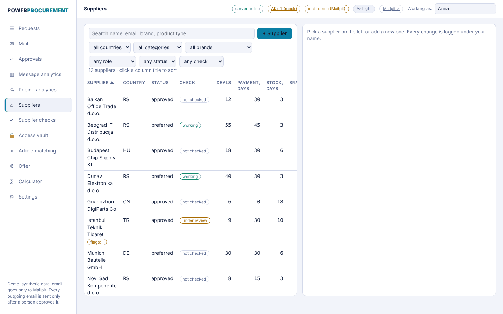

### Requests

The home tab lists every request with its stage and has the form for a new one. Click a request number to open
its **pipeline page**: one page, eight steps, top to bottom, with the next action always named under the title.

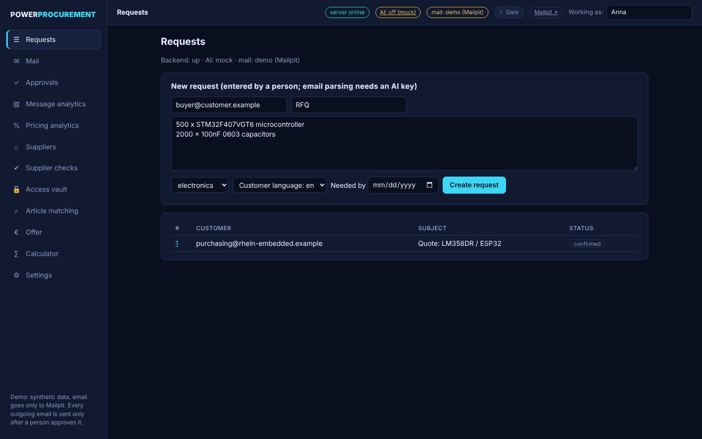

**Create a request by hand.** Sender, subject, one item per line as `500 x part name` (quantity first),
category, the customer's language and an optional *needed by* date, then **Create request**. Items without a
quantity are accepted but block supplier lookup until you fill the quantity in.

**On the pipeline page**

| Step on the page | What to do | What you get |
| --- | --- | --- |
| Items | Review what was extracted | The confirmed item list |
| **Steps 2-3 · Suppliers and target prices** | **Find suppliers and prices**; untick any supplier you do not want to ask | A shortlist with a reason per supplier ("covers 2/2 items; 40 past deals; RS"), at most five preselected |
| **Step 4 · Letters** | **Draft letters**, edit the text, **Approve and send to Mailpit** or **Reject** | One letter per supplier in that supplier's language (Serbian, English), status `draft`, `sent` or `rejected` |
| **Step 5 · Offers and scoring** | **Simulate supplier answers (demo only)**, move the five weight sliders, **Score** | A ranked table with every criterion, landed cost in EUR and lead time; **Quote this** on a row |
| **Steps 6-7 · Quote and outcome** | Set *Markup %* and the currency, approve the quote, then record the customer's answer | Quote with price, markup and cost tags; outcome `accepted`, `rejected`, `silence` or `counter-offer` (with the price they named) |
| **Step 8 · Order** | **Approve purchase order**, then **Approve invoice request** | PO with its budget checks; the invoice request letter |
| Price journal | Read only | Every price event: supplier cost, quote draft, quote sent, with who did it |

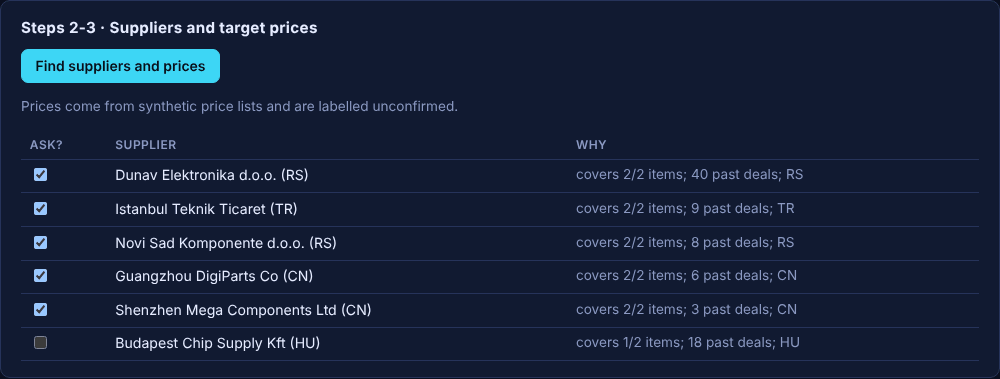

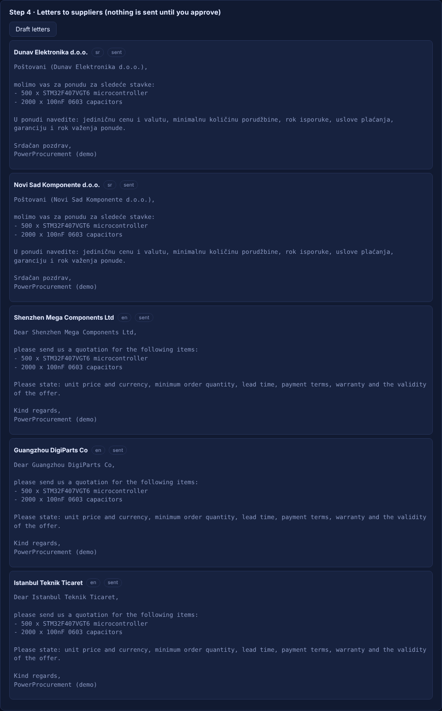

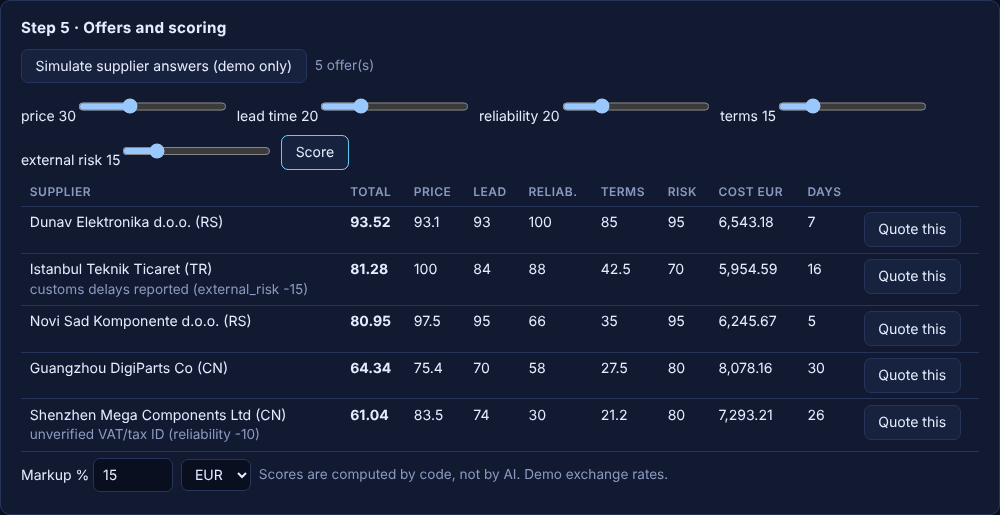

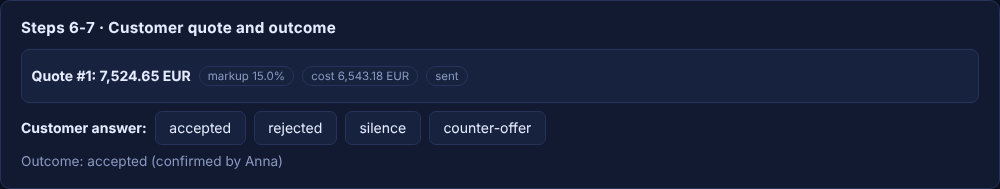

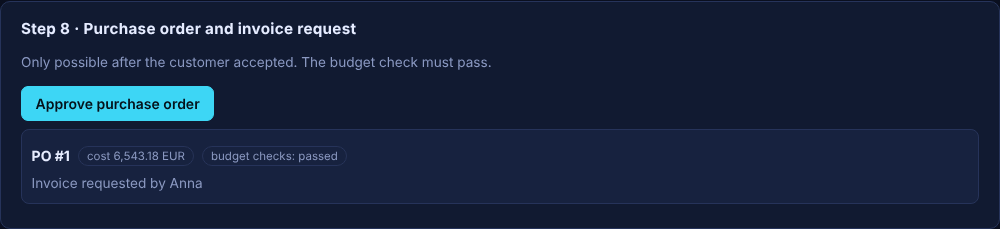

Notes: a supplier on the sanctions list, or one whose offer does not cover every item, is **excluded** and cannot
be quoted. A quote priced below cost is flagged *below cost* and cannot become an order.

### Mail

A mailbox with **All / Inbox / Sent** folders, search, and a detail pane. In the demo it holds sixteen synthetic
emails in English, Serbian (Latin and Cyrillic) and German, including newsletters and thank-you notes that are
**not** requests. Real inbox reading uses IMAP (see [configuration](#configuration-reference)).

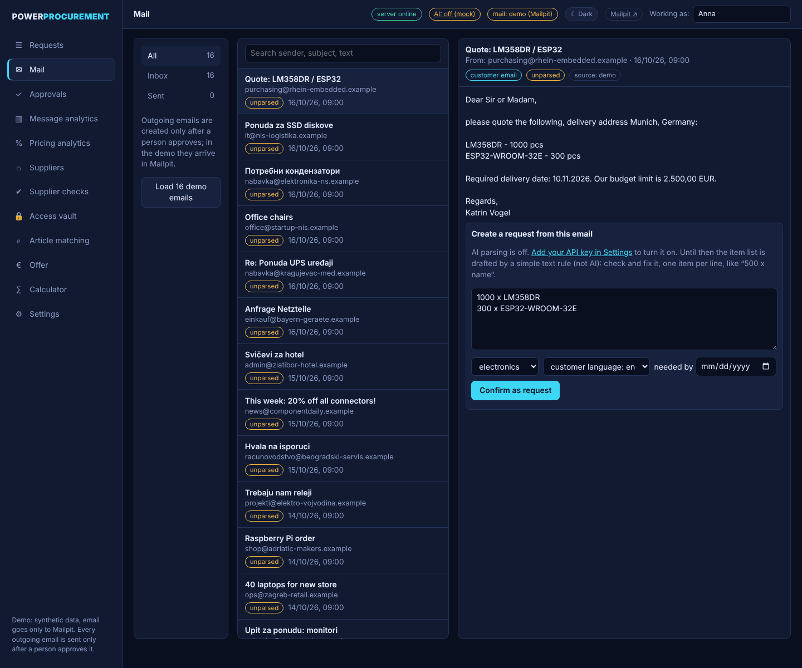

For an incoming email that has no request yet you get the **Create a request from this email** panel:

- **Parse with AI** (visible when AI is on) sends the email text to the Claude API and shows what it understood
  with a confidence value; you still confirm it.
- With AI off, the item list is drafted by a simple text rule. **Check and fix it**, pick category, language and
  *needed by*, then **Confirm as request**.

For an email that already has a request: **Open pipeline**, **Match articles**, **To the offer**. Sent mail shows
who approved it.

### Approvals

One queue for every letter waiting for a person: supplier letters (RFQs) and customer quotes. **Waiting for
approval** and **Decided** tabs, filter by *All / supplier RFQ / customer quote*.

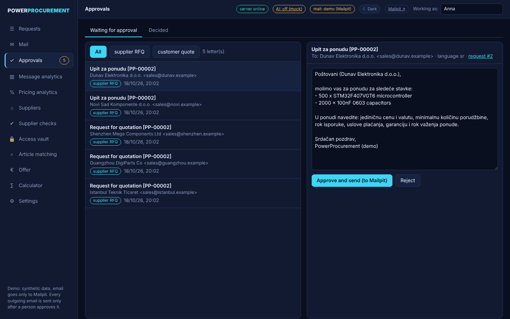

Pick a letter, read it, **edit the text in place** (edits are saved with your decision), then **Approve and send
(to Mailpit)** or **Reject**. Warnings (for example a price below cost) show in red on the letter. The number
beside *Approvals* in the menu is the count of letters waiting.

### Message analytics

Counted straight from the database: incoming emails per day (14 / 30 / 90 days), the funnel from email to order,
request statuses, email languages and categories, top senders, supplier RFQ response counts, customers' answers
to quotes, and items per request.

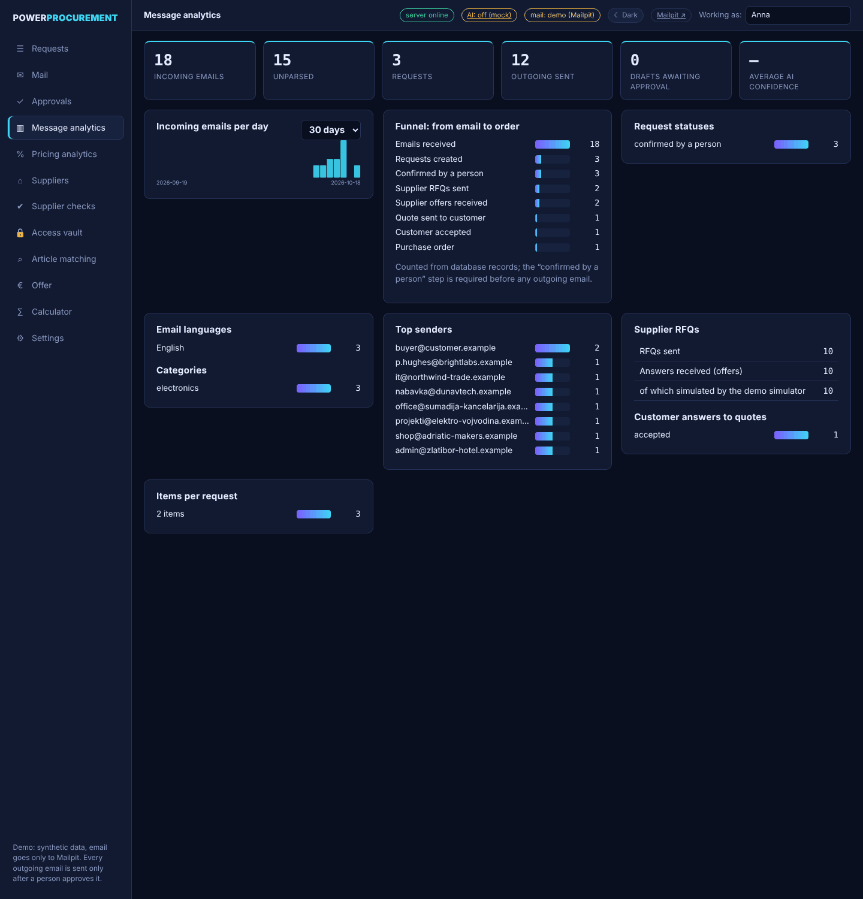

### Pricing analytics

How often a quote is accepted at each markup, and which markup earns the most (markup × win rate). Filter by
customer and category. The page shows quotes in view, acceptance rate, average markup, the average discount
customers asked for, and a **suggested markup** with the expected win rate and margin per euro of cost, a win
rate bar chart, a margin chart and a per-customer table. Bars with fewer than eight quotes are drawn faded.

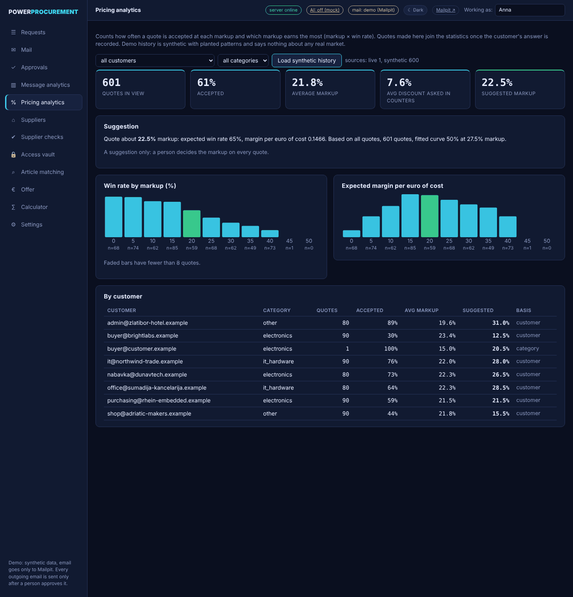

- **Load synthetic history** adds 600 invented quotes with planted patterns so the analysis has something to
  show. Their source is labelled *synthetic*; quotes you make yourself are labelled *live* and join the
  statistics once the customer's answer is recorded.
- The suggestion is only a hint. In **Offer** a **Use 22.5%** button copies it into the markup box; a person
  decides on every quote.

### Suppliers

Supplier storage with profiles, filters, sorting and price lists. Everything on this tab can be edited and every
edit is logged with your name.

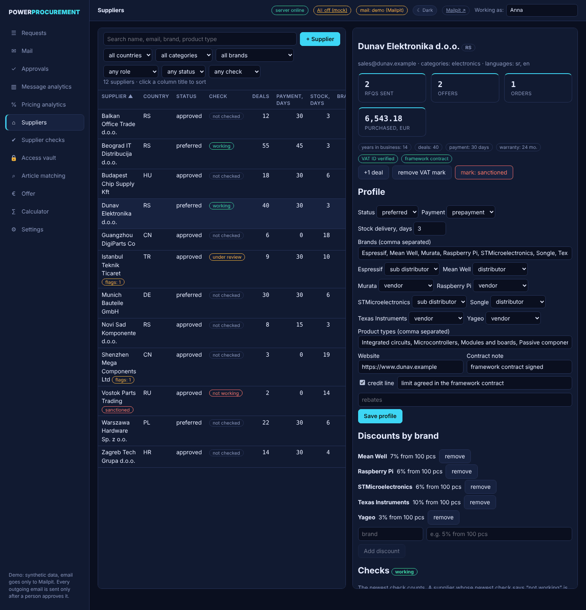

**Find and sort.** The search box looks in name, email, brands and product types. The dropdowns are **cascading**:
pick a country and the category and brand lists shrink to what exists there, with counts. Further filters: role
in a brand (*vendor, distributor, sub-distributor, reseller*), partner status and check result. **Click a column
title** to sort (click again to reverse); sorting runs on the server, empty values go last, ties break by name.
Sortable columns: supplier, country, status, check, deals, payment days, stock days, brands, price lines.

**Profile** (select a supplier, then edit under *Profile* and **Save profile**)

| Field | Meaning |
| --- | --- |
| Status | `new`, `approved`, `preferred`, `on hold` |
| Payment | `prepayment`, `on delivery`, `deferred`, `credit` |
| Stock delivery, days | Typical delivery time for items in stock |
| Brands | Comma separated; for each brand a role: vendor, distributor, sub-distributor or reseller |
| Product types | Comma separated |
| Website, contract note, credit line (with note), rebates | Free text and a tick box |
| Discounts by brand | A list such as *Texas Instruments: 10% from 100 pcs*; add and remove entries |

**Supplier facts used by scoring** are shown as tags (years in business, deals, payment days, warranty, VAT ID
verified, framework contract) with buttons to **+1 deal**, **mark/remove VAT mark** and **mark: sanctioned**. A
sanctioned supplier disappears from matching and mailings.

**Price list.** Each supplier has price lines (key, description, price, currency, MOQ, lead time, valid until).
Add a line by hand or **import a CSV**: choose a file or paste text, **Validate** (shows every row with its
errors), then **Import all or nothing**. Header and example:

```csv
keyword,description,unit_price,currency,moq,lead_time_days,valid_until
lm358,LM358 dual op-amp,0.21,EUR,100,5,2027-12-31
```

Commas, semicolons or tabs work as separators and a decimal comma is accepted (files up to 1 MB). One bad row
stops the import so a price list is never half-loaded.

**+ Supplier** opens the form for a new supplier (name, country code such as `RS`, categories, languages, sales email).

### Supplier checks

Is the supplier still reachable and still working? This tab keeps a **history of checks**: result (*working*,
*under review*, *not working*), who checked, who you spoke to, a note and the time. **The newest check counts.**

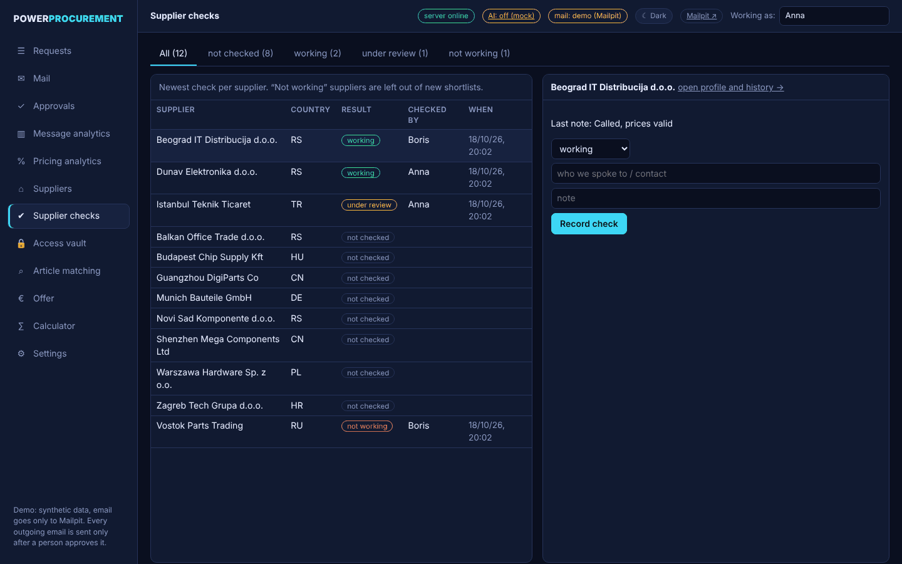

- Tabs filter by *All, not checked, working, under review, not working* with counts.
- Pick a supplier, choose a result, add the contact and a note, **Record check**. The same panel is in the supplier
  card under *Checks*, together with the full history.
- Effect on the pipeline: a supplier whose newest check is **not working** is **left out of new shortlists**.
  *Under review* stays in, with "check under review" added to the reason. Suppliers never checked stay in.

### Access vault

Logins and passwords for supplier portals, distributor shops, software and customer portals, kept encrypted.

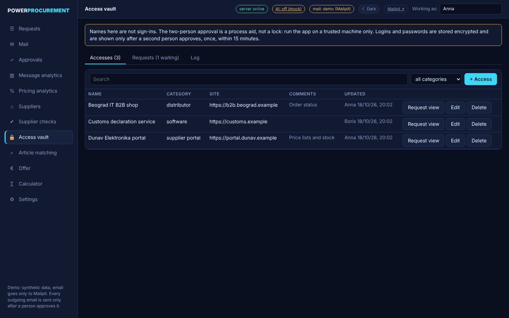

- **Accesses.** Add an entry (category, name, site URL, login, password, comments), search and filter by
  category, edit or delete. Lists never contain logins or passwords. When you edit, leave login or password
  empty to keep the stored value.
- **Requests, two-person rule.** **Request view** needs a reason. A **different** person (a different name in
  *Working as*) sees it under *Requests* and clicks **Approve** or **Reject** with an optional comment. After
  approval the requester clicks **Show once**: the login and password appear once, **within 15 minutes** of the
  approval, and the request becomes `used`.
- **Log.** Opening the vault, requests, decisions, reveals, edits and deletes, with who and when, never with the secrets.

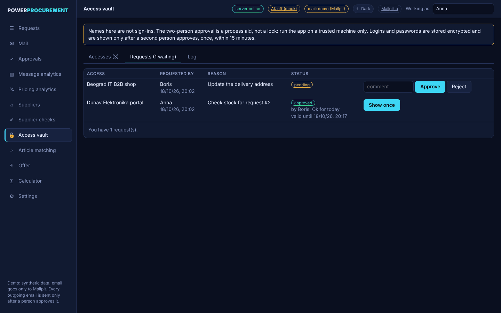

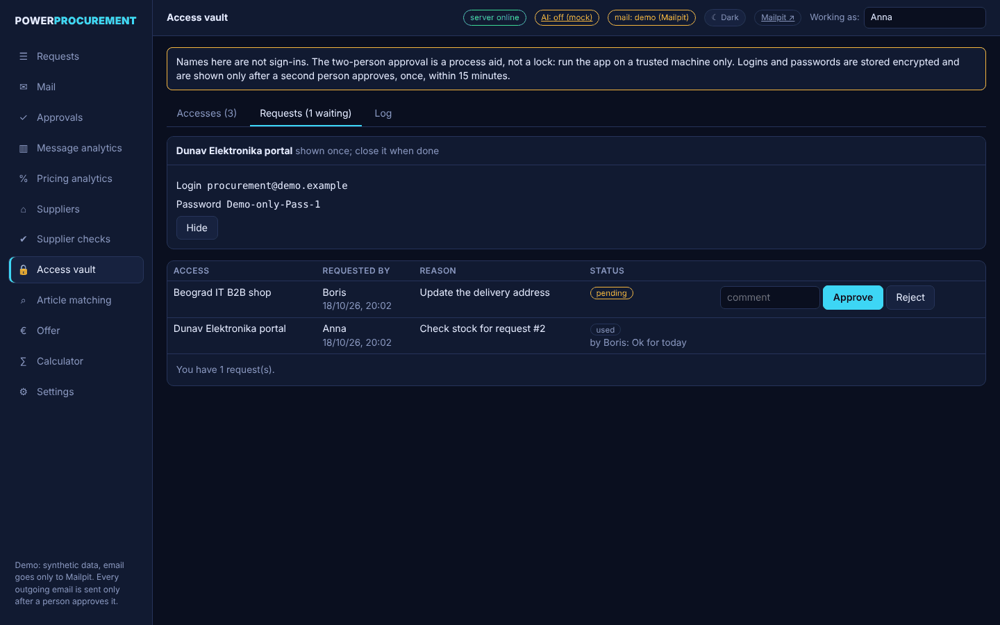

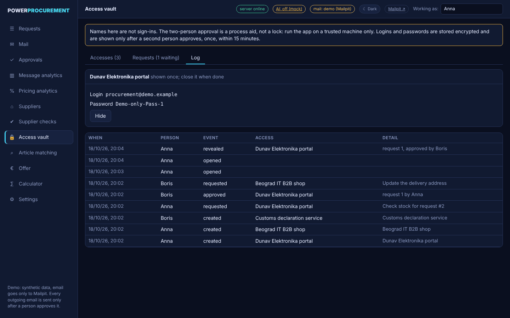

> **Honest limit.** The app has no sign-in: a name is typed into the top bar. The two-person rule is a process
> aid and an audit trail, not a lock, because anyone who can open the app can type a second name. Secrets are
> encrypted in the database (Fernet) and never reach a list, but run the app on a machine you trust.
> See [ADR 0009](docs/decisions/0009-profiles-checks-vault.md).

### Article matching

Two tabs. **Catalog search** looks through all price lists for a part, name or supplier (`stm32`, `0603`, ...).
**Request items** matches each item of a chosen request against the price lists and shows suppliers side by side:
price in the original currency, price in EUR per piece, MOQ, lead time, total for the requested quantity and a
*best price* badge; sanctioned suppliers are greyed out.

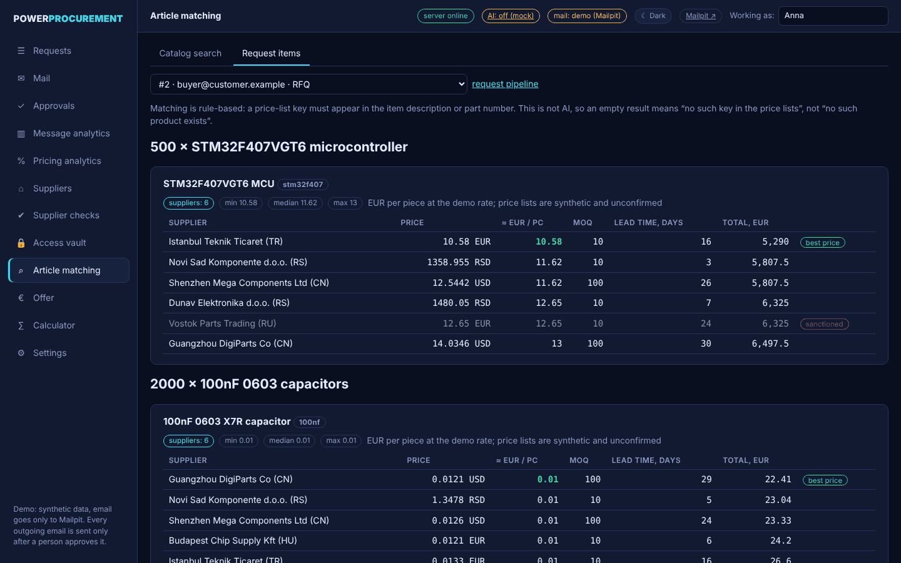

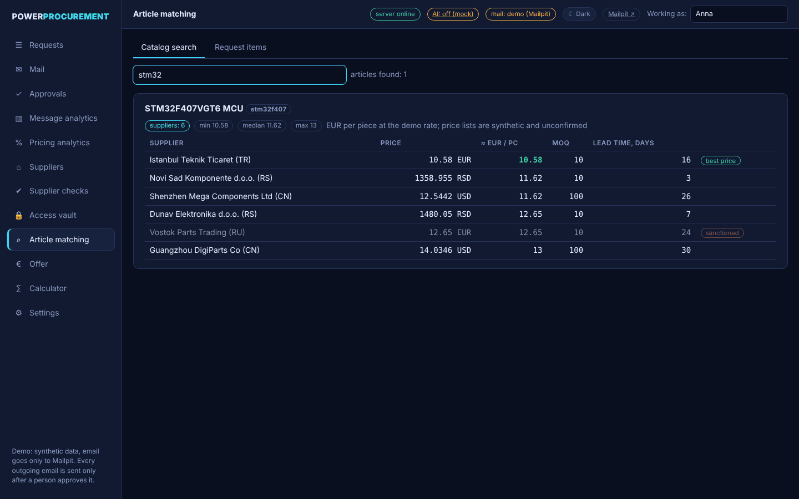

Matching is rule-based: a price-list key must appear in the item description or part number. It is **not AI**, so
an empty result means "no such key in the price lists", not "no such product exists". Add the part to a
supplier's price list on the Suppliers tab, or request an offer by hand.

### Offer

The offer builder: the pipeline's steps 5 to 6 on one screen with a **live margin preview**. Choose a confirmed
request, **Simulate supplier answers** (demo) and **Score**; the table lists offers with score, landed cost and lead time.
Click a row, set the **markup** (number box or slider, from -10% to 60%) and the currency (EUR, RSD, USD). Three
tiles show cost, customer price and margin in EUR and turn red when the price is below cost. **Create quote
draft** puts a letter in the approval queue.

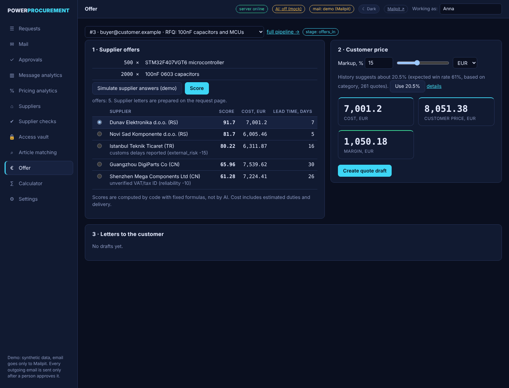

If the history has enough quotes you see a line such as *History suggests about 20.5% (expected win rate 61%,
based on category, 261 quotes)* with a **Use 20.5%** button.

### Calculator

A reserved tab. It reads **"Unique to the project"** and is where the project's own landed-cost calculator will go.

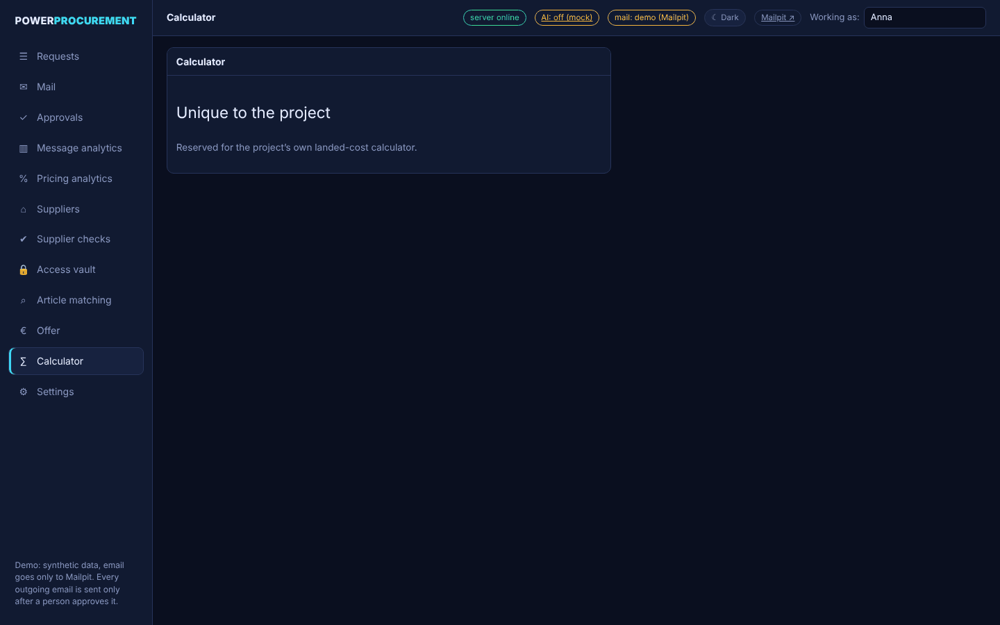

### Settings

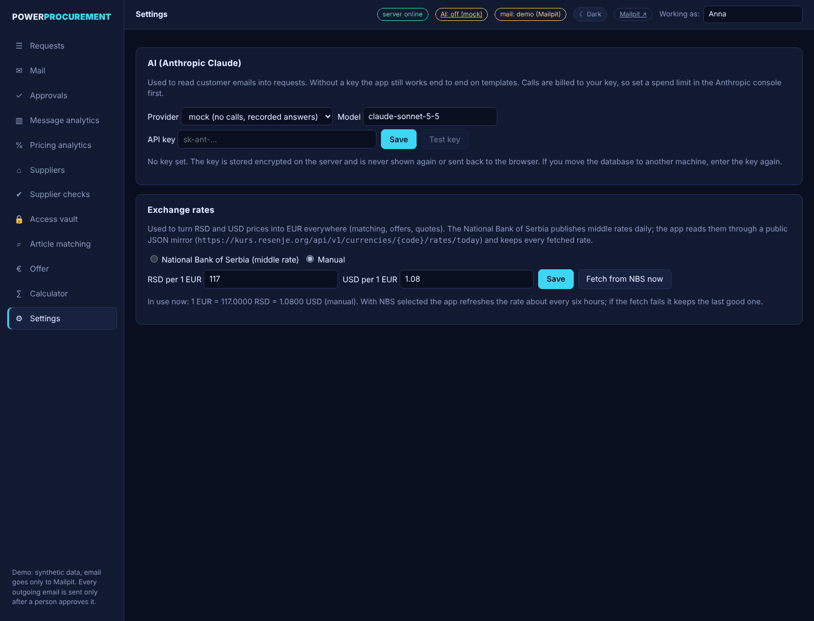

- **AI (Anthropic Claude).** Provider (`mock` or `anthropic`), model, and your API key with **Save**, **Test key**
  (one 8-token call, reports the result in plain words) and **Remove key**. See [Turning on the AI](#turning-on-the-ai).
- **Exchange rates.** Choose *National Bank of Serbia (middle rate)* or *Manual* with the RSD and USD per 1 EUR
  numbers. **Fetch from NBS now** reads the current rate on demand; with NBS selected the app refreshes about every
  six hours, keeps every fetched rate with its date and keeps the last good one when a fetch fails. The bank
  itself has no free JSON feed, so the app reads the public mirror `kurs.resenje.org`; the address is itself a setting.

### Mailpit (demo inbox)

Every email the app "sends" (supplier letters, quotes, purchase orders, invoice requests) is caught by
[Mailpit](https://mailpit.axllent.org/) at http://localhost:8025. Open it to see exactly what a supplier or customer
would have received.

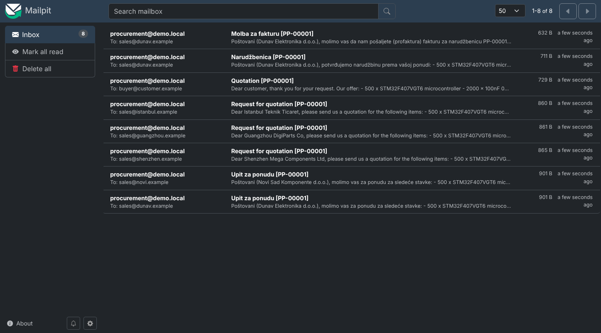

## How the numbers are computed

Everything below is code you can read (`backend/app/scoring`, `backend/app/pricing`, `backend/app/quotes`). AI never
changes a number.

**Landed cost.** Goods price in EUR, plus a demo model of freight and duty as a share of goods value by supplier
country: RS 3%, DE/PL/HU 5%, TR 12%, CN 18%, any other country 10%. These are proposals, not real tariffs.

**Hard filters.** A sanctioned supplier and an offer that does not cover every requested item are excluded before
scoring and shown last with the reason. Suppliers whose newest check says *not working* never reach the shortlist.

**Score** = weighted sum of five criteria, each 0 to 100. Default weights are 30 / 20 / 20 / 15 / 15 and you can
change them with the sliders on every request (they are normalised, so only the proportions matter).

| Criterion | Default weight | How it is scored |
| --- | --- | --- |
| Price | 30 | 100 × (target or best landed cost) ÷ this offer's landed cost |
| Lead time | 20 | 100 if within the days available; otherwise minus 10 points per late day (without a deadline: 100 minus the lead days, at most 60 off) |
| Reliability | 20 | 10 + 4 per year in business (up to 10) + 20 if the VAT ID is verified + 2 per past deal (up to 15), minus penalties for flags such as an unverified tax ID |
| Terms | 15 | 30 for a framework contract + up to 30 for payment days (60 days = full) + up to 25 for warranty (24 months = full) + 15 if the MOQ fits |
| External risk | 15 | 100 minus a country penalty (RS 5, DE/PL/HU 0, TR 15, CN 20, other 10) minus penalties for flags such as reported customs delays |

**Quote.** Customer price = landed cost × (1 + markup), converted at the bank rate. The preview shows cost, price
and margin before anything is created.

**Markup hint.** Pricing analytics groups quotes by markup bucket, counts how often they were accepted, fits a
win-rate curve and suggests the markup that maximises expected margin (markup × win rate). It uses the narrowest group with
enough quotes (the customer's own history, then the category, then all quotes) and always says which one.

**Purchase order checks.** Only after the customer **accepted**; the cost must be within `PO_BUDGET_LIMIT_EUR`
(50,000 EUR by default); the agreed price must not be below cost; one order per request.

## Safe by default

- **Nothing is sent outside the machine.** All mail goes to Mailpit. Real sending is a separate flag
  (`MAIL_REAL_SEND_ENABLED`, off) and, when on, limited to the addresses in `MAIL_ALLOWED_RECIPIENTS`.
  Real sending is environment-only on purpose and cannot be switched on from the browser.
- **Every outgoing message needs a named human approver** (`backend/app/mail/sender.py`).
- **AI never decides numbers.** It extracts and explains. Answers are schema-validated and carry a confidence
  score; below the threshold (0.75 by default) the item goes to a person.
- **A person confirms every request** before any supplier is contacted.
- **Secrets are encrypted** before they reach the database (API key, vault entries) and are never sent back to
  the browser; logs and the audit trail never contain them.
- **Names are not sign-ins.** The top-bar name is an audit label. Run the app on a machine and network you trust,
  or put your own authentication in front of it, before storing anything real.
- **CI never calls the live Claude API.** It replays recorded answers (`backend/app/ai/replay.py`). Prompts are
  versioned files (`backend/app/ai/prompts/`).
- **Demo data is synthetic.** No real customers, suppliers, prices or emails. Forecasts shown on demo data say
  nothing about any real market.

## Turning on the AI

Optional. Without a key everything works on templates.

1. Open **Settings**, set *Provider* to `anthropic`, paste your own [Anthropic API key](https://console.anthropic.com/)
   and click **Save**, then **Test key**.
2. Set a spend limit in the Anthropic console first: calls are billed to your key.
3. In **Mail**, an email without a request now offers **Parse with AI**. Only that button spends tokens.

The key is stored **encrypted** in the database; the encryption key is `APP_SECRET_KEY` or, if empty, a key generated
once into the `appdata` volume. It is never shown again and never goes back to the browser. A key saved in
Settings wins over `.env`. If you move the database to another machine, enter the key again.
Details: [ADR 0008](docs/decisions/0008-keys-in-app-and-nbs-rates.md).

### Parsing accuracy

16 synthetic gold emails (English, Serbian Latin and Cyrillic, German, and non-requests) live in
`backend/app/intake/gold/`. To measure the real model (a few cents; needs `ANTHROPIC_API_KEY` in the environment
or `.env`; keys saved in the Settings tab are used by the app, not by this command):

```bash
cd backend && AI_PROVIDER=anthropic uv run python -m app.intake.evaluate --live
```

The run records the answers, so later runs and CI replay them for free. **No accuracy figure is published here
until a live run has actually been made.**

## Configuration reference

Nothing is required. To change defaults copy `.env.example` to `.env` (never commit it). Values saved in the
Settings tab win over `.env`.

| Variable | Default | Meaning |
| --- | --- | --- |
| `POSTGRES_USER`, `POSTGRES_PASSWORD`, `POSTGRES_DB` | `powerprocurement`, `change-me`, `powerprocurement` | Database credentials for the compose database |
| `AI_PROVIDER` | `mock` | `mock` replays recorded answers; `anthropic` calls the live API |
| `AI_MODEL` | `claude-sonnet-5-5` | Model used for parsing and drafting |
| `AI_CONFIDENCE_THRESHOLD` | `0.75` | Extractions below this go to a person |
| `ANTHROPIC_API_KEY` | empty | Optional; you can enter it in Settings instead |
| `APP_SECRET_KEY` | empty | Fernet key that encrypts saved secrets; generated into the `appdata` volume if empty |
| `MAIL_REAL_SEND_ENABLED` | `false` | Real sending; off means everything goes to Mailpit |
| `MAIL_ALLOWED_RECIPIENTS` | empty | Comma separated allow-list used when real sending is on |
| `SMTP_HOST`, `SMTP_PORT`, `MAIL_FROM` | `mailpit`, `1025`, `procurement@demo.local` | Outgoing mail server and sender address |
| `IMAP_HOST`, `IMAP_PORT`, `IMAP_USER`, `IMAP_PASSWORD`, `IMAP_FOLDER`, `IMAP_SSL` | empty, `993`, ..., `INBOX`, `true` | Read a real inbox; leave empty in the demo |
| `FX_SOURCE` | `manual` | `nbs` for National Bank of Serbia middle rates |
| `FX_RSD_PER_EUR`, `FX_USD_PER_EUR` | `117.0`, `1.08` | Manual rates, units per 1 EUR |
| `DEFAULT_MARKUP` | `0.15` | Starting markup until analytics suggests one |
| `PO_BUDGET_LIMIT_EUR` | `50000` | Largest purchase order the system approves |

Reading a real inbox over IMAP and live Claude calls have not been exercised against real servers in this
repository's tests; both are covered by mocks and recorded answers.

## Architecture and repository layout

```
Browser ──> frontend (Next.js) ──/api──> backend (FastAPI) ──> Postgres
                                              │
                                              ├── ai/       one adapter: replay | recording | Claude API
                                              └── mail/     one sender: approval required, Mailpit by default
```

| Path | What lives there |
| --- | --- |
| `frontend/app/` | The panel: one folder per tab (`suppliers`, `checks`, `vault`, `quote`, ...), shared `components/` and `lib/` |
| `backend/app/intake/` | Email to structured request, gold set, evaluation |
| `backend/app/suppliers/` | Shortlist and supplier profiles, checks, sorting |
| `backend/app/pricing/`, `scoring/`, `quotes/`, `orders/` | Target prices, scoring formulas, markup and quotes, purchase orders |
| `backend/app/rfq/`, `mail/` | Letters, approval queue, the single mail sender, mailbox |
| `backend/app/analytics/` | Message analytics and markup analysis |
| `backend/app/vault/`, `runtime/` | Encrypted access vault; runtime settings, secret encryption, exchange rates |
| `backend/app/ai/` | The AI adapter and versioned prompts |
| `backend/migrations/` | Alembic migrations (0001 to 0007) |
| `docs/` | [Architecture](docs/architecture.md), [how the AI was directed](docs/ai-workflow.md), [decision records](docs/decisions/) |

Everything that talks to the outside world sits behind an adapter so it can be swapped or faked without touching
business logic. The rules above are enforced in code and covered by tests.

## Develop and test

Without Docker for the app itself (needs Python 3.12+, [uv](https://docs.astral.sh/uv/), Node 22 and a Postgres):

```bash
docker run -d --name pp-db -e POSTGRES_USER=pp -e POSTGRES_PASSWORD=pp -e POSTGRES_DB=pp -p 5432:5432 postgres:16-alpine
cd backend && uv sync
export DATABASE_URL=postgresql+psycopg://pp:pp@localhost:5432/pp
uv run alembic upgrade head && uv run python -m app.seed
uv run uvicorn app.main:app --port 8000                                       # API
cd ../frontend && npm ci && BACKEND_URL=http://localhost:8000 npm run dev     # panel on :3000
```

Checks, the same as CI (`.github/workflows/ci.yml`):

```bash
cd backend
uv sync
uv run ruff check . && uv run ruff format --check .
uv run alembic upgrade head && uv run pytest        # integration tests need DATABASE_URL (Postgres)
cd ../frontend && npm ci && npm run lint && npm run build
```

The backend suite has 83 tests (pipeline end to end, scoring, mail guard, settings, profiles and vault, analytics).
To see mail from a local run, start [Mailpit](https://mailpit.axllent.org/) on ports 8025 and 1025.

## Troubleshooting

| Problem | What to do |
| --- | --- |
| Buttons are greyed out | Type your name in *Working as* at the top |
| `port is already allocated` | Stop whatever uses 3000, 8000 or 8025 and run `docker compose up` again |
| The panel says *server unreachable* | The backend is still starting; wait for the compose log to show it healthy, then reload |
| *Parse with AI* is missing | AI is off: open Settings, choose `anthropic`, save a key |
| *Test key* says the key was rejected | Check the key in the Anthropic console; the app shows a plain reason (rejected, no access, model not found, rate limit, no network) |
| Vault says an access *cannot be decrypted* | The encryption key changed (new `APP_SECRET_KEY` or wiped volume); enter that access again |
| *Fetch from NBS now* fails | The rate mirror is unreachable from your network; the last good rate stays in use, or switch to *Manual* |
| Start over from scratch | `docker compose down -v`, then `docker compose up --build` |

## Roadmap

Each phase ends with an acceptance check; the next one starts only after it passes.

| Phase | Scope | Acceptance |
| --- | --- | --- |
| 0 | Scaffold: Docker, CI, database, AI adapter | `docker compose up` works, CI green (**done**) |
| 1 | Intake and parsing (step 1) | Parsing accuracy measured on a gold set of sr/en emails (**harness done, live measurement pending**) |
| 2 | Suppliers and prices (steps 2-3) | Shortlist and target prices for demo requests in three categories (**done on synthetic data; CSV price-list import; supplier profiles, checks, sorting; exchange rates from the National Bank of Serbia; live price sources pending**) |
| 3 | RFQ and approval queue (step 4) | Letters go through the approval queue into Mailpit (**done; letters are drafted from templates, AI drafting needs a key**) |
| 4 | Offers and scoring (step 5) | Comparison table; scoring covered by tests (**done**) |
| 5 | Customer quote and outcome (steps 6-7) | Quote passes markup approval; outcome recorded (**done**) |
| 6 | Order and invoice request (step 8) | End-to-end: email, quote, PO, invoice request (**skeleton works without AI; email parsing still needs a key**) |
| 7 | Analytics and markup | Test recovers patterns planted in the synthetic data (**done; real outcomes will replace synthetic ones**) |
| 8 | Publication | README, demo GIF, AI work log; runs in a minute (**README and install done; demo video pending**) |

Also done: encrypted access vault, dark / light theme. Not built: roles and sign-in, a detailed landed-cost
calculator (the Calculator tab is reserved for it), live price sources.

More: [architecture](docs/architecture.md) · [how AI was directed](docs/ai-workflow.md) ·
[decision records](docs/decisions/)

## License

[MIT](LICENSE)
