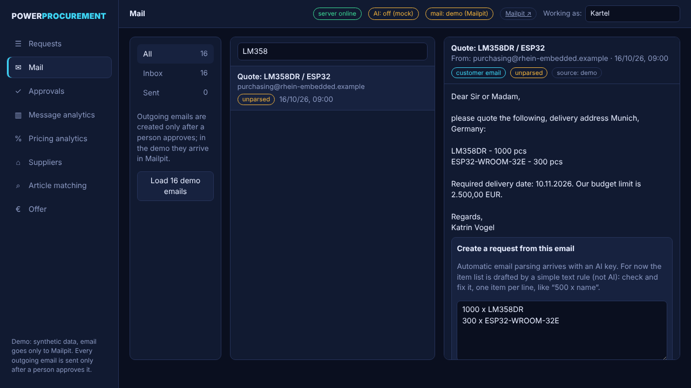
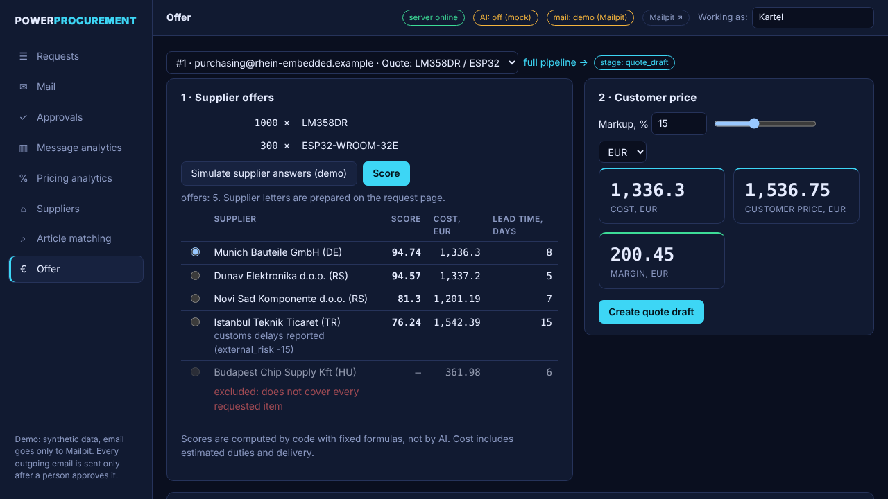
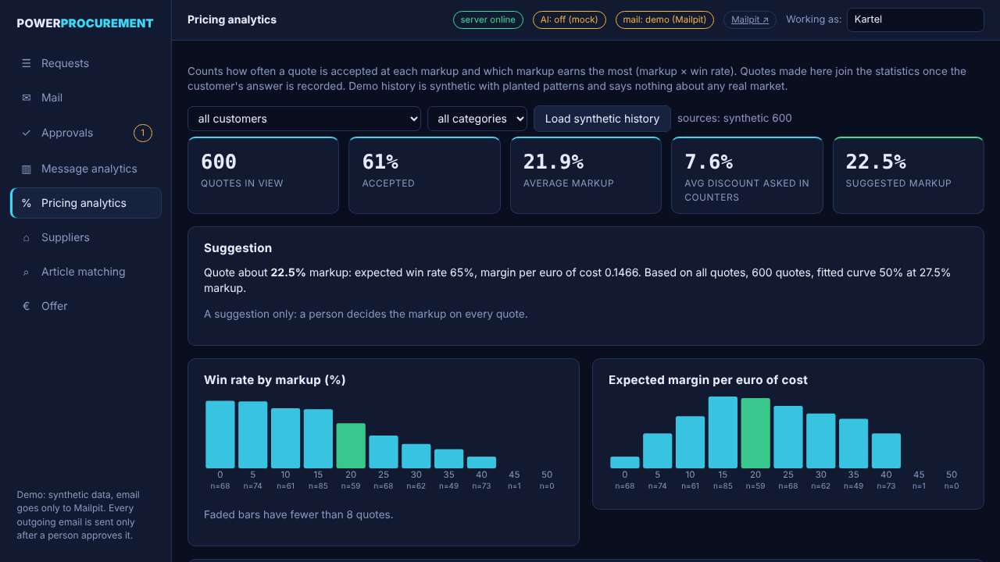
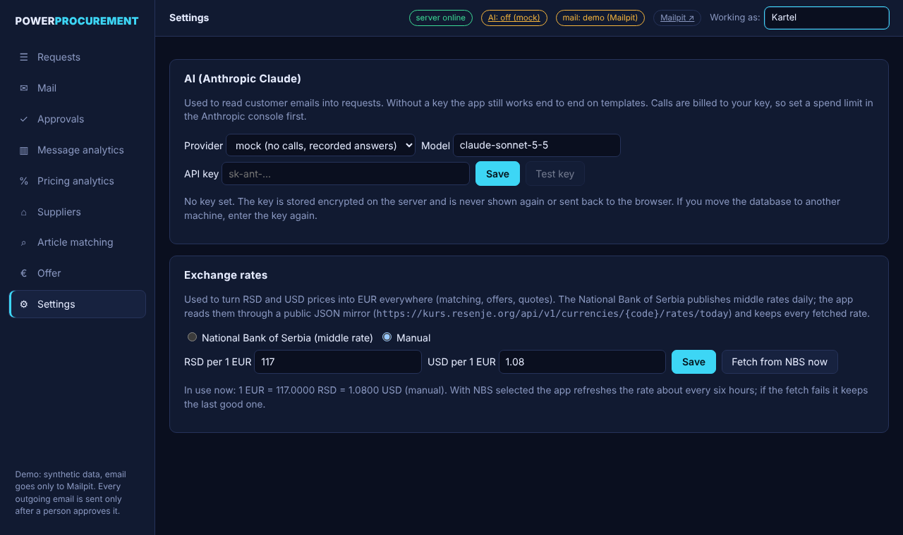
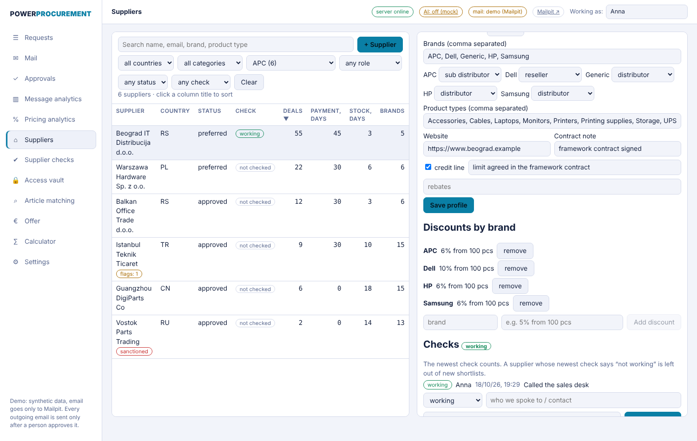

# PowerProcurement

From a customer's request email to an approved purchase order. AI does the routine work
(reads the email, drafts supplier and customer letters, extracts terms from replies). A human
approves every action that leaves the system. Scoring and pricing are plain deterministic code.

> **Status: walking skeleton.** The whole path works end to end on synthetic data and templates, with
> **no AI**: request, suppliers and target prices, letters with approval, offers and scoring, customer
> quote with markup, outcome, purchase order, invoice request. The AI steps (email parsing, drafting,
> extraction) have their interfaces and a gold set but are **not measured yet**; they need an API key.
> See the roadmap below.


| Mail to request | Quote with markup hint | Pricing analytics |
| --- | --- | --- |
|  |  |  |

## Install it on your machine

You need [Docker](https://docs.docker.com/get-docker/) with Compose and about 2 GB of free disk. Nothing else.

```bash
git clone https://github.com/KartelSRBX/PowerProcurement.git
cd PowerProcurement
docker compose up --build
```

The first start builds the images (a few minutes) and fills the database with synthetic demo suppliers.
When the log says the frontend is healthy, open the panel:

| What | Where |
| --- | --- |
| Web panel | http://localhost:3000 |
| API health | http://localhost:8000/health/ready |
| Demo inbox (Mailpit) | http://localhost:8025 |

No `.env` file is needed. Everything works at once on templates and synthetic data, with no AI and no outside accounts.
Nothing leaves your machine: all outgoing mail goes to Mailpit.

**Turn on the AI (optional).** Open **Settings** in the panel, choose provider `anthropic`, paste your own
[Anthropic API key](https://console.anthropic.com/) and press **Test key**. Mail then offers **Parse with AI**.
The key is stored encrypted on the server (in the database; the encryption key lives in the `appdata` volume),
is never shown again and never goes back to the browser. Calls are billed to your key, so set a spend limit in the
Anthropic console first. Keys can also be given through `.env` (see `.env.example`); a key saved in Settings wins.



**Exchange rates.** In **Settings** choose *National Bank of Serbia* to use its daily middle rates (fetched through the
public mirror kurs.resenje.org about every six hours, every fetched rate is kept) or enter rates by hand.

Stop with `Ctrl+C`; `docker compose down` removes the containers and keeps your data,
`docker compose down -v` also wipes the database and the saved key (a fresh start).
If a port is taken, stop the program using 3000, 8000 or 8025 first.

### The panel

A small CRM with tabs (English UI): **Requests** (requests and the step-by-step pipeline), **Mail**
(inbox and sent mail, create a request from an email), **Approvals** (one queue for every letter waiting for a person: edit, approve or reject; history of decisions), **Message analytics** (volumes, funnel, senders), **Pricing analytics** (win rate by markup, suggested markup per customer),
**Suppliers** (supplier profiles: brands, role per brand, discounts, payment and credit terms, partner status; cascading filters and sortable columns; price lists with CSV import: validate, preview, then import all or nothing), **Supplier checks** (is the supplier still working: a history of calls, the newest counts, and a supplier marked "not working" drops out of new shortlists), **Access vault** (portal logins stored encrypted; a login is shown only after a second person approves, once), **Article matching** (catalog search and
matching of request items) **Offer** (offer builder with a live margin preview), **Calculator** (reserved, "Unique to the project") and **Settings** (your Anthropic key, exchange-rate source).
The top bar has a dark / light theme switch (first visit follows your system; the choice is remembered). Type your name in the top bar first: every approval and edit is recorded under it. The name is not a sign-in: the vault's two-person rule is a process aid, so run the app on a machine you trust ([ADR 0009](docs/decisions/0009-profiles-checks-vault.md)).



### Try the flow (about two minutes)

1. Open http://localhost:3000, type your name in the top bar, click **Create request** (a sample request is prefilled). Or open **Mail**, load the demo emails and create a request from one.
2. **Find suppliers and prices**, then **Draft letters**, then approve each letter. They land in Mailpit.
3. **Simulate supplier answers** (demo only), move the weight sliders, **Score**, then **Quote this**.
4. Approve the quote, click **accepted** as the customer's answer, approve the purchase order and the invoice request.

Every outward step needs your name and is recorded. The purchase order is refused before the customer accepts
and when the agreed price is below cost.

## Safe by default

- **Nothing is sent outside the machine.** All mail goes to Mailpit. Real sending is a separate
  flag (`MAIL_REAL_SEND_ENABLED`, off) and, when on, limited to `MAIL_ALLOWED_RECIPIENTS`.
- **Every outgoing message needs a named human approver** (`backend/app/mail/sender.py`).
- **AI never decides numbers.** It extracts and explains. Answers are schema-validated and
  carry a confidence score; below the threshold the item goes to a person.
- **CI never calls the live Claude API.** It replays recorded answers
  (`backend/app/ai/replay.py`). Prompts are versioned files (`backend/app/ai/prompts/`).
- **Demo data is synthetic.** No real customers, suppliers, prices or emails. Forecasts shown
  on demo data do not reflect any real market.

## Develop

Without Docker for the app itself (needs Python 3.12+, [uv](https://docs.astral.sh/uv/), Node 22, and a Postgres):

```bash
docker run -d --name pp-db -e POSTGRES_USER=pp -e POSTGRES_PASSWORD=pp -e POSTGRES_DB=pp -p 5432:5432 postgres:16-alpine
cd backend && uv sync
export DATABASE_URL=postgresql+psycopg://pp:pp@localhost:5432/pp
uv run alembic upgrade head && uv run python -m app.seed
uv run uvicorn app.main:app --port 8000          # API
cd ../frontend && npm ci && BACKEND_URL=http://localhost:8000 npm run dev   # panel on :3000
```

Checks (the same as CI):

```bash
cd backend
uv sync
uv run ruff check . && uv run pytest        # integration tests need DATABASE_URL (Postgres)
cd ../frontend && npm ci && npm run lint && npm run build
```

## Parsing accuracy

16 synthetic gold emails (English, Serbian Latin/Cyrillic, German, non-requests) live in
`backend/app/intake/gold/`. To measure the real model (spends a few cents, needs `ANTHROPIC_API_KEY` in the
environment or `.env`; keys saved in the Settings tab are used by the app, not by this command):

```bash
cd backend && AI_PROVIDER=anthropic uv run python -m app.intake.evaluate --live
```

The run records the answers, so later runs and CI replay them for free. No figure is published
here until a live run has actually been made.

## Roadmap

Each phase ends with an acceptance check; the next one starts only after it passes.

| Phase | Scope | Acceptance |
| --- | --- | --- |
| 0 | Scaffold: Docker, CI, database, AI adapter | `docker compose up` works, CI green (**done**) |
| 1 | Intake and parsing (step 1) | Parsing accuracy measured on a gold set of sr/en emails (**harness done, live measurement pending**) |
| 2 | Suppliers and prices (steps 2–3) | Shortlist and target prices for demo requests in three categories (**done on synthetic data; CSV price-list import added; exchange rates from the National Bank of Serbia; live price sources pending**) |
| 3 | RFQ and approval queue (step 4) | Letters go through the approval queue into Mailpit (**done: Approvals tab; letters are drafted from templates, AI drafting needs a key**) |
| 4 | Offers and scoring (step 5) | Comparison table; scoring covered by tests |
| 5 | Customer quote and outcome (steps 6–7) | Quote passes markup approval; outcome recorded |
| 6 | Order and invoice request (step 8) | End-to-end: email, quote, PO, invoice request (**skeleton works without AI; email parsing still needs a key**) |
| 7 | Analytics and markup | Test recovers patterns planted in the synthetic data (**done: Pricing analytics tab, markup hint in Offer; real outcomes will replace synthetic ones**) |
| 8 | Publication | README, demo GIF, AI work log; runs in a minute |

More: [architecture](docs/architecture.md) · [how AI was directed](docs/ai-workflow.md) ·
[decision records](docs/decisions/)

## License

MIT
